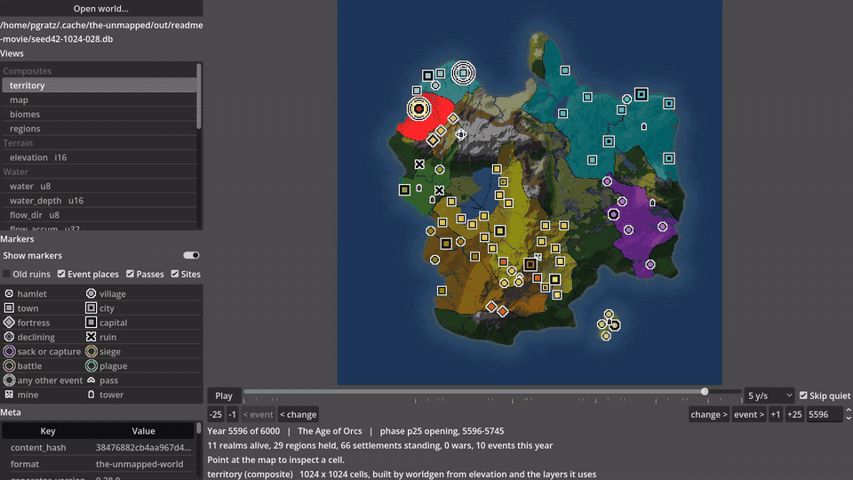
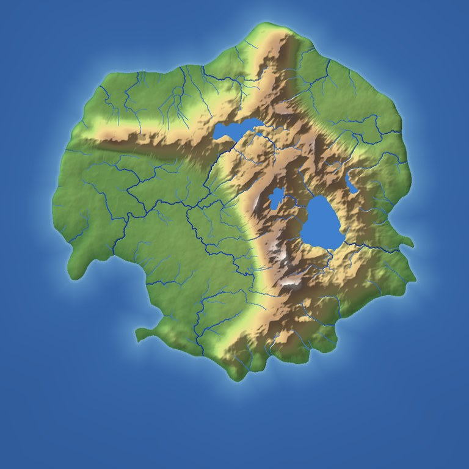
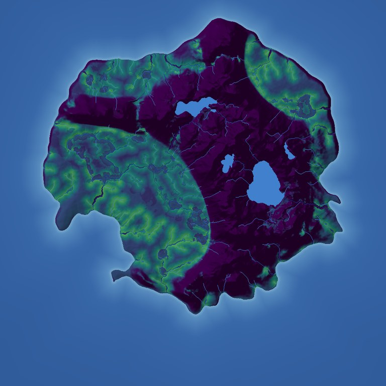
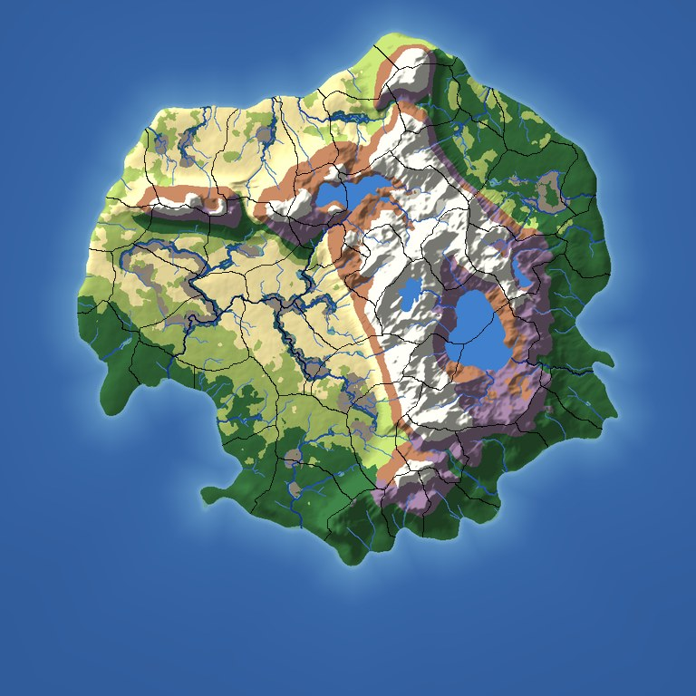

# The Unmapped

[](https://github.com/pgratz1/The-UnMapped/actions/workflows/ci.yml)

A single-player, first-person, open-world RPG whose world and history are generated from a seed. Dark high fantasy, exploration first, on flat screen and PC VR. The world generator is a headless C++20 library; the game will be a Godot 4 project whose logic lives in a C++ extension.

**This is an early-stage project.** There is no game yet. What exists today is the foundation of the world generator: a toolkit that writes reproducible world files and proves they are identical on every compiler. See [Status](#status) for exactly where things stand.



*The world viewer playing the four centuries of one realm's generated history (the Ghuughzuz Horde, seed 42, generator 0.28.0): territory by year, settlements and ruins as markers, and each event as a sentence. Every name, border and war comes from the seed.*

## Contents

- [The idea](#the-idea)
- [Status](#status)
- [Timeline](#timeline)
- [What works today](#what-works-today)
- [Build and run](#build-and-run)
- [How it is built to be reproducible](#how-it-is-built-to-be-reproducible)
- [Repository layout](#repository-layout)
- [How the project is developed](#how-the-project-is-developed)
- [Documents](#documents)
- [License](#license)

## The idea

A new world is generated once, from a seed. The generator builds the geography, then simulates several thousand years of history among the gods and peoples of that world: six races created in a fixed order, their civilizations, wars, migrations, monsters and ruin. Every ruin, dungeon, city, faction and quest in the playable world comes from that simulated history, so every place has a cause the player can discover.

Design pillars, in priority order:

1. **History explains the world.** Every site has a cause in the simulated past.
2. **Exploration is the reward.** Systems exist to make travelling and finding things interesting.
3. **Deterministic from the seed.** The same seed and generator version always give the same world, byte for byte.
4. **Flat screen and VR are equals.** Neither mode is a port of the other.
5. **Generator and game are separate programs.** The generator runs headless and is testable without the engine.

The project is two programs joined by one file:

```
seed + settings ──► worldgen (C++ library + CLI) ──► world.db (SQLite) ──► game (Godot 4 + C++ extension)
                    runs once per world              read-only in play     runs every session
```

The full design is in [`docs/design/design.md`](docs/design/design.md).

## Status

*Last updated: 2026-11-22.*

| | |
| --- | --- |
| **Current phase** | P4 Viewer v1 and P5 History depth, started 2026-11-22 in parallel. Of P4, the stages P4-01 (the timeline in the library: who holds which region in any year, civilization colours, and `render --composite territory [--year Y]`) and P4-02 (the layer catalogue and region names in the library, used by the viewer) are merged; the history view (P4-03) merged on 2026-11-23: the viewer reads a world's history, opens on a territory view at the present, and a year bar (buttons, slider and keys) steps through the years, to the next event or the next change of holder; each realm has a fixed colour by race, borders are black only between different holders, and pointing at the map says who holds the land and since when. The colour follow-ups (P4-03a) merged the same day, from the world critic's review: an olive fourth goblin shade, darker pale shades, borders in free land drawn as a darker line of the land's colour in place of black, and the hover text names a region as it was called in the year shown. Settlement and place markers (P4-04) merged on 2026-11-23: one marker per settlement that exists in the year shown, shaped by kind (hamlet to city, fortress), filled with its owner's colour, with marks for capitals, declining settlements, ruins and passes, and a coloured ring where a battle, siege, sack or plague happened that year; `worldgen-cli render --year Y --markers` draws the same overlay on any view, and in the viewer the markers sit above every view, scale with zoom and say on hover what a place is and how a ruin ended. The browser of civilizations and events (P4-05) merged on 2026-11-23: a right pane lists the civilizations and a filtered list of events (by civilization or place, six kind groups, year range); selecting a civilization shows its block of the history report with names as links and highlights its land, selecting an event jumps to its year, marks its place and shows participants, causes and effects, and with Follow on the year bar steps through the filtered list; names can be searched and a click on the map selects what is under it. The map is drawn as tiles so that a year change redraws in 21 ms where it took 170 ms, markers draw at double size at the fitted zoom, ruins are bolder and plague rings green. The history movie (P4-06) merged on 2026-11-24: Play runs the year bar through the browser's current list of events (a whole history, one civilization's story or only the wars) at 1 to 500 years per second, quiet years pass ten times faster and no year with an event is skipped; a ticker shows each year's sentences and a ring flashes at each event's place; `--play FROM TO --quit-at-end` under Godot's Movie Maker mode records a movie whose frames are the same on every run. With it every stage of P4 is merged; Paul reviewed the running viewer and approved the phase on 2026-11-24. Of P5, the first stage (P5-01, carried-over follow-ups) merged on 2026-11-23 (generator 0.21.0), from the world-critic reviews of the history report and Paul's decisions: a war is fought over the land it was declared for, orcs go to war within a few decades of awakening, grim region names are rarer, a battle's dead are counted once, and the history report (format v2) is shorter and lists open wars and standing claims; a default world has about 25 wars and 680 events. Regions renamed by history (P5-12) merged on 2026-11-23 (generator 0.22.0, schema 8): a region keeps its geographic name until history gives it another, after a conquest, the sack of a capital, a great slaughter or a plague ("After the slaughter, the Grove of Wrecks became known as the Red Wood"); about four regions in a default world are renamed, the report and the timeline use the name in force at the time, doubled human name endings are gone, and the name filter also applies where the parts of a region name join. Beasts and monsters (P5-02) merged on 2026-11-23 (generator 0.23.0, schema 9): five kinds of beast live in the regions that suit them, and six kinds of monster (dragon, ogre, undead host and others) wake, take a lair, raid the settlements around it, preferring small ones, and are hunted, slain or die out; a monster can overrun a settlement and lair in its ruin, and settlements now also end by plague, famine or being left, so a default world has about three overrun places and three ghost towns to explore, about eight monsters and twelve watchtower outposts; a ravaged region can take a name from its monster, and the history report (format v4) lists monsters and sites. Race relations, mixed settlements and migrations (P5-03) merged on 2026-11-24 (generator 0.24.0, schema 10): each pair of races that has met holds a disposition (hatred, wariness or friendship) that starts from the races' natures and moves with what their realms do to each other (wars, conquests, sackings, shelter given), and realms weigh it when they choose a quarrel; a settlement records the peoples living in it, so refugees and conquest make mixed towns (about eight in a default world), and a hated minority can be expelled; settlers flee a place a monster keeps raiding, bold beasts trouble the villages near them, a monster's raids follow on from its earlier ones, and a ruin left by flight, plague or famine stays on the map; the history report (format v5) has a `[peoples]` block. Its follow-ups (P5-03a) merged on 2026-11-25 (generator 0.25.0; history report format v6): peoples now also grow friendlier, through a century of peace between neighbours, a shared enemy or shelter given to refugees, so about a third of the changes of disposition are toward friendship where almost none were; peoples shut in by a closed pass can meet by word carried through others; settlers of another people join a town in varying numbers; the undead rise where many have died and through the whole history rather than mostly in its last centuries; and the summary is shorter (about 550 lines for a default world). Alliances, trade, mines and arms (P5-04) merged on 2026-11-25 (generator 0.26.0, schema 11; history report format v7): realms form alliances, in friendship, against a common enemy or after trade, renew them, let them lapse, break or betray them; an ally called to a war joins, refuses or withdraws, fights in its partner's battles and is owed a share of the spoils, and a withheld share ends the alliance; elves and faeries begin allied; no bloc of allies may hold more than seven tenths of the land; realms open trade with neighbours; dwarves open mines, which are places on the map, and sell arms; a default world has about 14 alliances, of which nine stand at the end, an ally in a quarter of its wars, 15 trade links and two mines; the history report has an `[alliances]` block, and the viewer shows mines as markers and lists alliance events as their own group. P5-06 figures (generator 0.27.0, schema 12, history report format v8) merged on 2026-11-25: history now has named people. Each realm has a line of rulers with regnal numbers and epithets, whose temper bends the realm's wars; a succession can be disputed and the loser exiled to another realm; generals are appointed, lead battles and fall in them; heroes rise against monsters and slay them or are slain; casters found towers, which are places on the map (a library beside a settlement or a tower in the wild), and write books. A default world has about 77 figures. No ruin fades any more: ruins older than 1,500 years are drawn as old ruins. A realm's summary now lists its major calamities. Monsters were recalibrated so that a living monster stands at the end in 92 of 100 default worlds. The history report has a `[figures]` block, and the viewer has a Figures tab and tower markers. Targets narrowly missed and left for the follow-up stage are listed in `docs/reviews/p5-06-figures-validation.md`. P5-04a relations and alliances follow-ups (generator 0.28.0, history report format v9) merged on 2026-11-26: it answers the world critic's notes on alliances and figures. An ally that refuses a call to arms now has a motive (fear of the foe, weariness of war, a grasping ruler and others), and some refusals are excused; a betrayal states its motive. A first withheld share of spoils sours an alliance and a second, or a large one, ends it. Renewals are written only when something happened in the term. A battle won with newly bought dwarven arms says so. Two peoples who put aside a hatred do not turn again for centuries, and a people settled for 800 years is expelled only soon after a fresh turn to hatred. Wizard towers are kept apart and end with their settlement or realm. The report's summary names a ruler, a hero, a caster and a general for each world and lists living monsters first. In a default world calls to arms are now joined more often than refused (917 joined against 782 refused over 100 worlds), a living monster stands at the end in 94 of 100 worlds, and about three in ten of the monsters slain fall to a hero. P3 History core, started 2026-11-19 and reviewed and approved by Paul on 2026-11-22: the overview and the first three stage specs are approved. History data and settings (P3-01) merged on 2026-11-19 (generator 0.12.0): the six races, their cultures and the history tuning are data files, and `generate` accepts the world-creation settings (history span, detail, races present and others), which do not change a world yet. Names (P3-02) merged the same day (no world change): a library that builds names for gods, civilizations and settlements from each culture's syllables, unique across a world, and the keyed random draws every history decision uses. Chronology (P3-03) merged on 2026-11-19 (generator 0.13.0, schema 6): a world now records which races are present, the year each awakens, the ages between, and a named creator god for each race. All seven stage specs are approved. The simulation engine (P3-04) merged on 2026-11-19 (generator 0.14.0, schema 7): the history stage divides the span into simulated phases and quiet intervals and writes an event log with causes, civilizations, settlements and region control; Peoples (P3-05) merged on 2026-11-20 (generator 0.15.0): each race founds civilizations in the lands that suit it, settlements grow from hamlets to cities, peoples colonise within reach of their capitals, famine and plague strike in active phases, realms split by secession and failing settlements are abandoned; a default world has about ten civilizations, ninety settlements and 550 events. Expansion and conflict (P3-06) merged on 2026-11-20 (generator 0.16.0): civilizations claim neighbouring land and go to war over it, with battles, sieges, sacked and captured settlements, truces and ceded regions; a default world has about 24 wars and 820 events, and most ruins are now made by war. Names and peoples follow-ups (P3-08) merged on 2026-11-20 (generator 0.17.0), from the world-critic reviews and Paul's decisions: regions have names without numerals drawn from word lists ("the Wood of Stags"), generated names pass a filter, faeries live in forest, dwarves found fortresses on high, ore-rich ground, and the event log is quieter (a default world has about 650 events). Conflict balance (P3-09) merged on 2026-11-20 (generator 0.18.0), from the world-critic review of conflict and Paul's decisions: a people's last refuge can flee into hiding instead of being destroyed, a lost war costs the loser land or tribute, the winner of the last battle never loses the war, faeries are hard to find rather than strong in battle, and no race goes extinct in 375 test worlds; a default world has about 23 wars and 730 events. Wording, site and conflict follow-ups (P3-10) merged on 2026-11-21 (generator 0.19.0), from two world-critic reviews and Paul's decisions: the log names plague outbreaks and quiet stretches of at least fifty years and says why wars and migrations happen, each land type has one plain compass name, faeries live inland and dwarves on high ground, an attacker wins a war only by holding its goal with no defender left standing in it, orcs awaken with a quarrel and stay hidden for a shorter time, and the long test suites now run in continuous integration; a default world has about 23 wars and 680 events. Orc arrival, wording and name follow-ups (P3-11) merged on 2026-11-22 (generator 0.20.0), from the second world-critic review of P3-10 and Paul's decision on faerie names: orcs awaken in numbers and send out their first colony at once, so they act within about a decade of awakening where they used to wait two centuries, and the last age is the most violent; claims and ceded footholds name the towns at stake; faerie names lose their `p` and `b` sounds, no name in any culture repeats a syllable twice in a row, and counts from one to nine are written as words; a default world has about 25 wars and 680 events. The history report (P3-07) merged on 2026-11-22 (no world change): `worldgen-cli report --history` prints a world's history as text, at a summary level of the most notable events or in full; its text is identical on every compiler and platform, like the world itself. P0 Foundation, P1 Geography (reviewed and approved by Paul on 2026-11-19) and P2 Godot bring-up and viewer v0 are complete |
| **Next phase** | P6 Derivation and polish, after P4 and P5 |
| **Current milestone** | Milestone 0, Geography generator: met and approved by Paul on 2026-11-19. Now working towards milestone 1, History generator |
| **Work in flight** | P1: elevation and hydrology are merged, so `generate` writes a continent with ranges, passes, rivers and lakes. Elevation followed five rounds of design exploration and two world-critic reviews (`docs/reviews/`): irregular continents, long segmented ranges with 2,000 to 2,500 m peaks, valleys cut by erosion, and a guaranteed share of mountains in every world. Generator 0.6.0 (2026-11-17) added natural passes at saddles of each range's drainage divide, after five more exploration rounds and three critic reviews: a pass is cut by at most 500 m, so naturally low saddles become low gates and others stay high cols, and about two in five are walkable end to end at the default map size. Pass sites are stored in a `pass` table for the history simulation (the first schema change, version 2). Very steep faces are bounded by a final slope-relaxing step. Climate merged the same day (generator 0.7.0): temperature falls with height and from south to north, and each world has one prevailing wind that makes ranges wet on the windward side and dry in the lee. Biomes merged on 2026-11-18 (generator 0.8.0, schema 3): alpine, highland moor, marsh, forest and grassland by rules held as data, with forest thresholds scaled to map size; the biome definitions and the world's wind direction are stored in the world file. A variety revision merged the same day (generator 0.9.0, schema 4; Paul's decisions of 2026-11-17): heath, steppe, wet woodland along large rivers and fens on wet lowland bring the count to nine natural biomes, each world draws its own temperature offset of up to 2 °C either way (stored in the world file), and the coastal forest ring is thinner. Validated on 271 worlds; a world-critic review (`docs/reviews/p1-04b-biome-variety-critic.md`) notes two follow-ups, a visible heath stripe on some worlds and blocky fen patches on the largest maps. Resources and habitability merged on 2026-11-18 (generator 0.10.0, schema still 4): six score layers (fertility, ore, timber, fresh water, forage and habitability, each 0 to 255 and absolute, so a harsh world reads as harsh) and a layer of walkable areas, for the history simulation to place homelands, farms, mines and settlements. Habitability weighs farmland most, then wild food, timber and ore, and treats fresh water as a necessity. Validated on 271 worlds; a world-critic review (`docs/reviews/p1-05-resources-critic.md`) led to a tuning revision before the merge and records the remaining limits. Regions, the last geography stage, merged on 2026-11-19 (generator 0.11.0, schema 5): land is divided into named regions of about 2 km² each, roughly 13, 50 and 200 per map, with borders on ridge crests and large rivers, upland regions of their own for wide massifs, and placeholder names such as "Northwest Steppe II" until history renames them. Three new tables give the history simulation each region's summary (area, biomes, mean resource scores, walkable ground, reachable ore) and each border's length, lowest crossing, river and pass. A world-critic review (`docs/reviews/p1-06-regions-critic.md`) led to a revision before the merge (each pass belongs to one border; mountain and lake regions get fitting names). Validated on 271 worlds (`docs/reviews/p1-06-regions-validation.md`): a default world takes about 9 seconds and 6.5 MB. The viewer gained a regions view, a legend and a description of the cell under the mouse. Paul reviewed and approved the geography phase on 2026-11-19 and accepted the world critic's recommendations, among them the default map size (1024) as the reference size for history. P3 History core started the same day with its overview spec: the shared model of years, ages, peoples and the event log that the history stages build on. |
| **`main`** | Builds and passes all tests on Linux (GCC, Clang, Clang with sanitizers) and Windows (MSVC), in debug and release |

**What "P0 done" means.** The phase's exit check is that an empty world file is byte-identical across all three compilers and that `worldgen-cli hash` proves it in continuous integration. It does: eight test worlds, six empty and two holding test layers, are identical across all seven build configurations, and each matches its recorded golden hash. CI repeats the comparison on every push. With geography stages merged the comparison covers twelve worlds, four of them full maps with elevation and hydrology at 512 and 1024.

**Since P0 was first completed**

- Paul reviewed P0 and merged its fourteen proposals into the design document.
- Seed phrases are now scrubbed, a design change made at that review. This changed the bytes of phrase worlds, so the generator version went from 0.1.0 to 0.2.0 and all golden hashes were re-recorded: the first use of the version rule.

**Known gaps and notes**

- Geography is complete as planned: elevation, hydrology, climate, biomes, resources and regions. History does not exist yet.
- Region limitations (`docs/reviews/p1-06-regions-critic.md`): lowland borders are plain distance borders, not natural lines; some large rivers run inside a region; placeholder names repeat heavily on the largest maps (up to "Northeast Wood XXIX"); islets of any size are regions.
- Resource score limitations (`docs/reviews/p1-05-resources-critic.md`): the banks of large rivers score slightly below their hinterland, lowland areas differ little from each other, and rich ore is often on crags that cannot be reached on foot. Small maps (512) are mostly mountain and leave little room for homelands.
- Biome limitations (`docs/reviews/p1-04-biomes-critic.md`), being addressed by the revision in progress: every range has the same ring of moor on its wet and dry sides; the first kilometre of most coasts is forest; marsh is thin ribbons; rivers through grassland have bare banks.
- At the largest map size about one world in twenty has very little high ground or a peak above the intended maximum (`docs/reviews/p1-04-biomes-validation.md`, defects D1 and D2); to be fixed in elevation.
- Climate limitations (`docs/reviews/p1-03-climate-critic.md`): rainfall depends on map size (small maps are wetter); every world has the same temperature range; the wind direction is not stored yet; passes do not channel moisture.
- Known elevation limitations are listed in section 11 of the elevation spec and in `docs/reviews/p1-01b-elevation-passes-critic.md`. The main ones: low gates on small maps can cut a range down nearly to the plain; a pass sometimes erases a mountain lake on its crossing; about two in five small (512) worlds get no pass; on a rare small map a range drops into the sea as a very steep smooth face (512, seed 41); filled basins among peaks can look smooth; a few worlds get ring-shaped ranges. Rivers on gently sloping lowland run in angular steps (`docs/reviews/p1-02-hydrology-critic.md`).
- The only registered data kind is generator tuning (`game/data/worldgen/`); biomes, races and the rest come with their phases.
- The noise primitive's output stays within about two thirds of its nominal range, which is normal for this kind of noise; the P1 elevation spec needs to account for it.
- The `render` image-size limit is tested only on the "too large" side.
- The sanitizer build's test suite takes about four minutes, mostly one noise range test.
- Agent-written commits before 2026-11-15 credit "Claude Fable 5.2" although Opus subagents wrote them; later commits credit the model that wrote them.

## Timeline

The first block of work is the world generator prototype: seven phases, P0 to P6, that together deliver milestones 0 and 1 and a viewer. Game milestones 2 to 10 follow. Phases marked "parallel" can run at the same time once their dependencies are done.

### World generator prototype

| Phase | Delivers | Depends on | Status |
| --- | --- | --- | --- |
| **P0 Foundation** | Repository layout, CMake presets, vendored dependencies, CI on three compilers, the deterministic core, the reproducible SQLite layer, the TOML loader, `worldgen-cli` | — | **Done** 2026-11-15, reviewed |
| **P1 Geography** | Elevation, erosion, hydrology, climate, biomes, resources and regions, each writing its layer; image export per layer | P0 | **In progress** since 2026-11-15: first three specs approved, shared foundation, elevation and hydrology merged (2026-11-16); natural passes merged (2026-11-17, generator 0.6.0, schema 2); climate merged (2026-11-17, generator 0.7.0); biomes merged (2026-11-18, generator 0.8.0, schema 3); biome variety revision merged (2026-11-18, generator 0.9.0, schema 4); resources and habitability merged (2026-11-18, generator 0.10.0); regions merged (2026-11-19, generator 0.11.0, schema 5). **Done** 2026-11-19, reviewed and approved by Paul |
| **P2 Godot bring-up and viewer v0** | Godot version pinned, C++ extension building on Linux and Windows, `world.db` reader bound into Godot, 2D map with switchable layers | P0; parallel with P1 | **Done** 2026-11-15, awaiting Paul's hands-on review. Godot 4.7.2 and godot-cpp 10.0.0 pinned; the extension builds and its headless check passes on Linux and Windows |
| **P3 History core** | Race and culture definitions, ages and the awakening schedule, active phases and quiet intervals, civilizations, settlements, wars, ruin, the event log, a text history report | P1 | **In progress** since 2026-11-19: overview and all seven stage specs approved; history data and settings (generator 0.12.0), names, and chronology (generator 0.13.0, schema 6) merged (2026-11-19); simulation engine (generator 0.14.0, schema 7) merged (2026-11-19); peoples (generator 0.15.0) merged (2026-11-20); conflict (generator 0.16.0) and the names and peoples follow-ups (generator 0.17.0) merged (2026-11-20); conflict balance (generator 0.18.0) merged (2026-11-20); wording, site and conflict follow-ups (generator 0.19.0) merged (2026-11-21); orc arrival, wording and name follow-ups (generator 0.20.0) merged (2026-11-22); the history report merged (2026-11-22). **Done** 2026-11-22, reviewed and approved by Paul |
| **P4 Viewer v1** | Timeline scrubber, territory by year, settlement and site markers, browser for civilizations and events | P2, P3; parallel with P5 | **Done** 2026-11-24, reviewed and approved by Paul: the timeline, layer catalogue, history view, markers, browser of civilizations and events, and the history movie (P4-01 to P4-06) |
| **P5 History depth** | God interventions, beast populations, named monsters, figures and factions, race relations, casters and spellbooks | P3 | **In progress** since 2026-11-22: P5-01 (generator 0.21.0) and P5-12 regions renamed by history (generator 0.22.0, schema 8) merged (2026-11-23); P5-02 beasts and monsters (generator 0.23.0, schema 9) merged (2026-11-23); P5-03 race relations, mixed settlements and migrations (generator 0.24.0, schema 10) merged (2026-11-24); P5-03a relations follow-ups (generator 0.25.0) merged (2026-11-25); P5-04 alliances, trade, mines and arms (generator 0.26.0, schema 11) merged (2026-11-25); P5-06 figures (generator 0.27.0, schema 12) merged (2026-11-25); P5-04a relations and alliances follow-ups (generator 0.28.0) merged (2026-11-26); next: P5-07 mountain depths, then the pantheon with cults and artifacts; a factions stage (guilds founded in history) follows P5 before P6 |
| **P6 Derivation and polish** | Sites, dungeon records, quest hooks and spellbook placement derived from history; world-creation settings on the command line; 3D heightmap preview | P4, P5 | Not started |

```
P0 ██████████ done ──┬─► P1 Geography ██ done ──► P3 History core ──┬─► P5 History depth ──┬─► P6 Derivation
                     │                              (you are here)         │                      │
                     └─► P2 Viewer v0 ██ done ─────────────────────────────┴─► P4 Viewer v1 ──────┘
```

### Milestones

| # | Milestone | Reached when | Status |
| --- | --- | --- | --- |
| 0 | Geography generator | `worldgen-cli` writes a world with all geography layers; maps look plausible in image export and in the viewer; identical file hash on Linux and Windows | **Met**, approved by Paul 2026-11-19: all geography layers are written (P1), the viewer shows them (P2), and the file hash is identical across GCC, Clang and MSVC on Linux and Windows |
| 1 | History generator | Default history generates in under two minutes; races appear in order; the event log reads as coherent history; sites and quest hooks derived | In progress (P3 started 2026-11-19; P3 to P6) |
| 2 | Walkable terrain | Godot streams terrain from a world file; the player can cross the map on flat screen without hitches | Not started |
| 3 | VR parity | The same build starts in VR or flat; the fly-across test holds 90 Hz in VR | Not started |
| 4 | Biomes and wilderness | Six biomes with generated materials, rocks and vegetation; rivers, lakes and roads | Not started |
| 5 | Settlements | A generated city and villages with enterable interiors furnished with physics objects | Not started |
| 6 | Dungeons | Graph-based dungeons for two origin types, full of physics objects, in both modes | Not started |
| 7 | Core play | Combat, book-learned spells, skill progression, inventory, dialogue and saving in both modes | Not started |
| 8 | History in play | Quests from hooks, books and dialogue rendered from real history, local-LLM dialogue. First playable version | Not started |
| 9 | Voice dialogue | Speaking to NPCs and hearing replies, all on local models | Not started |
| 10 | Spell research | Composing, researching and casting new spells within the rules | Not started |

Milestones 0 and 1 carry the most design risk, since they decide whether generated history is interesting. Milestones 2 and 3 carry the most technical risk.

### What P0 delivered

| Stage | Spec | What it is |
| --- | --- | --- |
| Deterministic core | [`p0-01`](docs/specs/p0-01-deterministic-core.md) | One fixed-point number type (32 integer and 32 fractional bits), the project random generator (xoshiro256\*\*), seed streams derived by hashing the seed with a stage name or coordinates, integer gradient noise, integer square roots, SHA-256 |
| World database | [`p0-02`](docs/specs/p0-02-world-db.md) | A reproducible SQLite file: pinned build options, a `meta` and a `layer` table, a compact layer codec, a writer that makes the bytes independent of write order, and a read-only reader |
| TOML loader | [`p0-03`](docs/specs/p0-03-toml-loader.md) | Settings file, data-file discovery and validation in a fixed order, a content hash, and no floating point on the path to the generator |
| `worldgen-cli` | [`p0-04`](docs/specs/p0-04-worldgen-cli.md) | `generate`, `render`, `report` and `hash` |

Around them: about 300 automated test cases, 2,201 golden vectors for the core produced by an independent Python reference, a second independent Python check of world-file contents, a lint for constructs that break determinism, and a CI job that compares world hashes across every compiler.

## What works today

`worldgen-cli` writes world files and inspects them. A generated world currently holds a table of mountain passes and a table of biome definitions, the world's wind direction and temperature offset, and eleven geography layers (elevation; water, water depth, flow direction, flow accumulation, rivers, lakes and distance to the coast from hydrology; temperature and rainfall from climate; biomes) on a 512, 1024 or 2048 cell map at 16 m per cell. Since generator 0.13.0 it also holds the first history tables: the races present, the year each awakens, the ages between, and a named creator god for each race. Since 0.14.0 it also holds a history: phases, an event log with causes, civilizations, settlements with their populations, and which civilization holds each region; since 0.15.0 that history is of peoples growing, colonising, suffering famine and plague, and splitting; since 0.16.0 they also press claims on each other's land and fight wars, with battles, sieges, sacked and captured settlements, truces and ceded regions; since 0.18.0 wars end with a winner, tribute or a truce, and a people driven from its last home can flee into hiding; since 0.19.0 the log also records plague outbreaks and long quiet stretches, and gives the cause of wars and migrations; since 0.20.0 the orcs act from their first years, and claims and cessions of single towns name them; since 0.21.0 a war is fought over the land it was declared for; since 0.22.0 (schema 8) history can rename a region, and the table `region_name` records each name with the year it began; since 0.23.0 (schema 9) beasts and named monsters live in it, with their lairs and raids; since 0.24.0 (schema 10) the races hold dispositions toward each other and settlements record the peoples living in them; since 0.25.0 those dispositions also warm, through long peace, a common enemy and shelter given; since 0.26.0 (schema 11) realms hold alliances and trade links, and dwarven mines are sites; since 0.27.0 (schema 12) it records named figures (rulers, claimants, generals, heroes and casters) and the books casters write, wizard towers are sites, and no ruin fades; since 0.28.0 an ally that refuses a call or betrays an alliance has a stated motive, and a withheld share of spoils sours an alliance before it ends one. `report --history` prints that history as a readable text.

```
$ worldgen-cli generate --seed-phrase "The Unmapped"
/home/you/.cache/the-unmapped/out/world-15629206466951235176.db

$ worldgen-cli report --db ~/.cache/the-unmapped/out/world-15629206466951235176.db
# worldgen report v2
[meta]
content_hash = 38476882cb4aa967d4cfd4da62042553307ab73da44cd1393b40c2f5c5a997a7
format = the-unmapped-world
generator_version = 0.28.0
history_end_year = 6000
param.civs_per_race = auto
param.divine_activity = normal
param.divine_script =
param.event_intensity = normal
param.history_detail = normal
param.history_span = 6000
param.map_size = 1024
param.monster_pressure = normal
param.races = elf,goblin,dwarf,faerie,human,orc
schema_version = 12
seed = 15629206466951235176
seed_phrase = the unmapped
stages = elevation,hydrology,climate,biomes,resources,regions,chronology,history
[tables]
age = 6
beast = 5
beast_population = 604
biome = 12
book = 8
civilization = 11
climate = 1
culture = 6
event = 898
event_cause = 699
event_kind = 92
event_kind_role = 211
event_kind_value = 97
event_participant = 1971
event_value = 1340
figure = 64
god = 6
layer = 19
meta = 17
monster = 8
monster_kind = 6
pass = 3
phase = 22
race = 6
race_biome = 48
race_relation = 56
region = 51
region_biome = 255
region_border = 126
region_control = 41
region_name = 4
relation = 163
settlement = 100
settlement_census = 1306
settlement_race = 138
site = 23
[layers]
elevation i16 1024x1024 codec=1 bytes=1175180 min=-2306 max=19803
water u8 1024x1024 codec=1 bytes=34948 min=0 max=3
water_depth u16 1024x1024 codec=1 bytes=640156 min=0 max=2306
flow_dir u8 1024x1024 codec=1 bytes=236314 min=0 max=8
flow_accum u32 1024x1024 codec=1 bytes=468500 min=0 max=120835
river u8 1024x1024 codec=1 bytes=27457 min=0 max=8
lake u32 1024x1024 codec=1 bytes=2234 min=0 max=4
coast_dist i16 1024x1024 codec=1 bytes=1022256 min=-6579 max=5008
temperature i16 1024x1024 codec=1 bytes=274872 min=-65 max=84
rainfall u16 1024x1024 codec=1 bytes=1019690 min=497 max=4535
biome u8 1024x1024 codec=1 bytes=48513 min=1 max=12
fertility u8 1024x1024 codec=1 bytes=164027 min=0 max=255
ore u8 1024x1024 codec=1 bytes=185325 min=0 max=255
timber u8 1024x1024 codec=1 bytes=113153 min=0 max=255
fresh_water u8 1024x1024 codec=1 bytes=360860 min=0 max=255
forage u8 1024x1024 codec=1 bytes=196390 min=0 max=255
habitability u8 1024x1024 codec=1 bytes=255314 min=0 max=199
walk_area u16 1024x1024 codec=1 bytes=24902 min=0 max=2
region u16 1024x1024 codec=1 bytes=23636 min=0 max=51
[geography]
cells = 1048576
land_cells = 419430
ocean_cells = 629146
land_fraction = 0.4000
landmasses = 1
largest_landmass_share = 1.0000
coastline_m = 60320
coast_ratio = 1.6421
land_solidity = 0.8933
elevation_m = 0.1 4.3 41.8 64.2 114.9 538.2 941.0 1531.7 1980.3
depth_m = 2.9 140.8 230.6
land_above_m = 50:0.8351 500:0.2686 1000:0.0842 1500:0.0119 2000:0.0000
max_step_m = 77.2
step_p999_m = 60.8
slope_over = 35:0.3103 45:0.2163
slope_p50_above_500m = 1.1798
lowland_flat_share = 0.0162
edge_parallel_run_m = 2288
passes = 3
natural_gaps = 0
passes_capped = 1
pass_col_m = 257.8 316.7 579.4
passes_walkable = 2
lakes = 4
lake_cells = 12438
lake_share_of_land = 0.0297
largest_lake_cells = 7820
river_cells = 8370
river_share_of_land = 0.0200
river_sources = 208
river_mouths = 49
major_rivers = 15
longest_river_m = 11685
largest_basin_share = 0.2881
wind_toward = NW
temp_offset_c = -1.0
temperature_c = -6.5 -0.7 4.2 6.1 7.7
rainfall_mm = 497 553 706 1457 4535
land_below_0c = 0.1249
rain_contrast = 2.6347
biome_share = temperate_forest:0.2927 grassland:0.1449 marsh:0.0053 highland_moor:0.1038 alpine:0.1533 blighted_waste:0.0000 heath:0.0798 steppe:0.1646 wet_woodland:0.0182 fen:0.0374
biome_patches = 475
scores_p50 = fertility:72 ore:0 timber:26 fresh_water:139 forage:89 habitability:40
scores_p90 = fertility:255 ore:81 timber:255 fresh_water:235 forage:180 habitability:142
fertile_share = 0.3921
habitable_share = 0.4303
ore_rich_share = 0.0668
walk_areas = 2
walk_main_share = 0.6155
walk_share = 0.6259
regions = 51
region_area_km2 = 0.82 1.78 5.25
region_borders = 126
region_borders_walkable = 95
region_borders_river = 19
region_borders_pass = 3
regions_isolated = 0
regions_upland = 9
[chronology]
races_present = 6
awakening_years = 0 2094 3327 4226 5036 5638
age_years = 2094 1233 899 810 602 362
age_years_min = 362
gods = 6
[history]
end_year = 6000
phases_opening = 6
phases_quiet = 10
phases_flare = 5
phases_final = 1
simulated_years = 1362
simulated_permille = 227
events = 898
events_awakening = 6
events_civ_founded = 8
events_settlement_founded = 8
events_quiet_era = 0
events_flare_up = 5
events_colony_founded = 90
events_became_village = 22
events_became_town = 61
events_became_city = 0
events_settlement_dwindled = 5
events_famine = 46
events_plague = 0
events_plague_spread = 67
events_succession_crisis = 20
events_civ_seceded = 3
events_settlement_abandoned = 0
events_capital_moved = 5
events_civ_ended = 0
events_ruin_faded = 0
events_claim = 31
events_war_declared = 17
events_battle = 29
events_battle_at_pass = 0
events_siege = 26
events_sacked = 6
events_settlement_captured = 11
events_peace = 3
events_truce = 4
events_region_ceded = 4
events_civ_conquered = 0
events_settlement_abandoned_to = 4
events_refugees_settled = 2
events_tribute = 5
events_war_won = 9
events_search_abandoned = 1
events_refuge_held = 0
events_plague_outbreak = 83
events_quiet_stretch = 9
events_claim_settlements = 0
events_settlements_ceded = 0
events_claim_dropped = 1
events_refuge_hidden = 2
events_region_renamed = 4
events_monster_appeared = 7
events_undead_rose = 1
events_monster_woke = 4
events_monster_slept = 10
events_monster_raid = 29
events_settlement_overrun = 1
events_monster_slain = 1
events_monster_driven_off = 1
events_monster_died = 4
events_beasts_bold = 2
events_outpost_built = 8
events_outpost_abandoned = 7
events_settlement_fled = 2
events_peoples_met = 14
events_disposition_turned = 5
events_refugees_arrived = 2
events_settlement_mixed = 4
events_standing_changed = 0
events_people_expelled = 0
events_alliance_formed = 15
events_alliance_renewed = 19
events_alliance_lapsed = 1
events_alliance_broken = 0
events_alliance_betrayed = 1
events_ally_joined_war = 4
events_ally_refused = 3
events_ally_withdrew = 1
events_allied_battle = 6
events_trade_opened = 19
events_trade_broken = 5
events_spoils_shared = 2
events_spoils_withheld = 0
events_alliance_spurned = 0
events_mine_opened = 1
events_arms_sold = 2
events_came_to_rule = 8
events_figure_died = 53
events_succession_disputed = 9
events_exiled = 6
events_reigned_at_end = 11
events_general_appointed = 5
events_battle_led = 14
events_fell_in_battle = 0
events_hero_rose = 1
events_monster_slain_by_hero = 0
events_hero_slain = 0
events_tower_founded = 5
events_book_written = 8
events_blight = 0
civilizations = 11
civilizations_alive = 11
settlements = 100
settlements_standing = 89
regions_held = 26
census_rows = 1306
relations = 163
region_names = 4
beasts = 5
monster_kinds = 6
beast_populations = 604
monsters = 8
sites = 23
race_relations = 56
settlement_races = 138
figures = 64
books = 8
population = 170983
population_elf = 5358
population_goblin = 133853
population_dwarf = 10754
population_faerie = 7373
population_human = 4365
population_orc = 9280
settlements_standing_elf = 4
settlements_standing_goblin = 64
settlements_standing_dwarf = 4
settlements_standing_faerie = 11
settlements_standing_human = 1
settlements_standing_orc = 5
regions_held_elf = 1
regions_held_goblin = 16
regions_held_dwarf = 1
regions_held_faerie = 5
regions_held_human = 1
regions_held_orc = 2

$ worldgen-cli hash --db ~/.cache/the-unmapped/out/world-15629206466951235176.db
4766b0254dfa896b1efae22c8eedef4732976822ae525e34ef127297c5afa811

$ worldgen-cli render --db ~/.cache/the-unmapped/out/world-15629206466951235176.db --composite map
/home/you/.cache/the-unmapped/out/world-15629206466951235176.map.png
```

The history of the same world, as a readable report (`--level full` lists every event; the excerpt is cut at each `...`):

```
$ worldgen-cli report --db ~/.cache/the-unmapped/out/world-15629206466951235176.db --history
# worldgen history v9
level = summary
...
[ages]
a1 The Age of Elves: 0-2093, 2094 years; Elves (ra1) made by Esis (g1, good); 1 civilization founded: 1 at the awakening, 0 by secession
a2 The Age of Goblins: 2094-3326, 1233 years; Goblins (ra2) made by Slatbeex (g2, evil); 2 civilizations founded: 2 at the awakening, 0 by secession
a3 The Age of Dwarves: 3327-4225, 899 years; Dwarves (ra3) made by Nukgarin (g3, neutral); 1 civilization founded: 1 at the awakening, 0 by secession
a4 The Age of Faeries: 4226-5035, 810 years; Faeries (ra4) made by Sofosh (g4, good); 2 civilizations founded: 2 at the awakening, 0 by secession
a5 The Age of Humans: 5036-5637, 602 years; Humans (ra5) made by Birdsten (g5, neutral); 2 civilizations founded: 1 at the awakening, 1 by secession
a6 The Age of Orcs: 5638-5999, 362 years; Orcs (ra6) made by Uul'duk (g6, evil); 3 civilizations founded: 1 at the awakening, 2 by secession
[chronicle]
threshold = 26
events = 898
shown = 246
== a1 The Age of Elves: 0-2093
-- p1 opening: 0-149, 150 years; trigger e1; 8 events
...
[civilizations]
c1 The Realm of Lecier
  race: Elf (ra1)
  home: Stagbarrow Tangle (rg34), temperate_forest
  founded: 0 in The Age of Elves (a1), e2
  capital: Vaenies (s1)
  peak regions: 2, 1675-2497
  peak population: 8769 in 3093
  settlements: 5 founded, 4 held at the end, 0 ruined
  wars: 0 declared, 7 defended; won 1, lost 3, drawn 3, open 0
  adversaries: 10
    The Warrens of Skruz-Snugg (c2): 4 wars, won 1, lost 1, drawn 2, open 0, 2498-4011; now at peace
    The Gnokkirk Horde (c3): 3 wars, won 0, lost 2, drawn 1, open 0, 2494-3418; now at peace
  events: 118
  fate: alive in 6000: 1 region, 4 settlements, population 5358
  milestones: 3
...
[present]
year: 6000
civilizations alive: 11 of 11
...
c10 The Warrens of Beenkgnazz: 1 region, 3 settlements, population 4522
c11 The Bink-Zark Mob: 1 region, 3 settlements, population 8007
regions: 51; held 26, free 25
settlements: 100; thriving 78, declining 11, ruined 11
settlement kinds: hamlet 0, village 34, town 58, city 0, fortress 8
largest settlement: Gnix (s7), population 7884
ruins: 11
  s19 Snunkskink Hole in Hound's Wolds (rg25): ruined 3120, e166 sacked by The Warrens of Skruz-Snugg (c2); last held by The Realm of Lecier (c1)
  s34 Gnuskrot Hole in The Rout of Skruz-Snugg (rg30): ruined 5992, e882 sacked by The Gnokkirk Horde (c3); last held by The Warrens of Skruz-Snugg (c2)
  s48 Nog in Yewholt (rg39): ruined 4026, e296 abandoned after famine, survivors to Arvies (s5); last held by The Gnokkirk Horde (c3)
  s50 Nonkskiz in Ragsike Leas (rg42): ruined 3367, e220 abandoned for fear of The Brood of Geex-Snix (m4), survivors to Gasluzz Hole (s20); last held by The Gnokkirk Horde (c3)
  s68 Sotwee Glade in Briarbrake (rg13): ruined 5735, e639 abandoned after plague, survivors to Lallsae (s75); last held by The Liemouvie Ring (c5)
  s71 Dulromford in Whinfurrow Leas (rg40): ruined 5216, e442 sacked by The Gnokkirk Horde (c3); last held by The Duchy of Rudgor (c7)
  s85 Moldham in The Fallen Downs (rg27): ruined 5941, e808 sacked by The Warrens of Skruz-Snugg (c2); last held by The Duchy of Rudgor (c7)
  s87 Gearham in The Fallen Downs (rg27): ruined 5945, e821 sacked by The Warrens of Skruz-Snugg (c2); last held by The Duchy of Rudgor (c7)
  s90 Edurdwick in The Fallen Downs (rg27): ruined 5948, e834 sacked by The Warrens of Skruz-Snugg (c2); last held by The Duchy of Rudgor (c7)
  s95 Osh'duush in The Forsaken Steppe (rg26): ruined 5919, e783 abandoned for fear of The Host of Wayfarer's Steppes (m7), survivors to Boz'uguum (s88); last held by The Warband of Kal (c9)
  s96 Ghaashuurk in The Forsaken Steppe (rg26): ruined 5821, e715 overrun by The Host of Wayfarer's Steppes (m7); last held by The Warband of Kal (c9)
hidden refuges: 1 of 2 founded by flight
  s98 Weckham in Northwest Steppe (rg9): The Duchy of Rudgor (c7), population 4365, founded 5948 by flight from Edurdwick (s90), e835
open wars: 0
standing claims: 5
  e273 3777 The Realm of Lecier (c1) on The Gnokkirk Horde (c3): Yewholt (rg39)
  e515 5638 The Warband of Kal (c9) on The Warrens of Skruz-Snugg (c2): Brandgap Plains (rg18)
  e785 5926 The Skrab Mob (c8) on The Duchy of Rudgor (c7): The Fallen Downs (rg27)
  e813 5943 The Realm of Lecier (c1) on The Warrens of Skruz-Snugg (c2): Hound's Wolds (rg25)
  e864 5985 The Gnokkirk Horde (c3) on The Bink-Zark Mob (c11): The Bloody Steppe (rg24)
renamed regions: 4
  rg24: The Bloody Steppe since 5713, e626 after e624 battle; formerly Wayfarer's Steppes
  rg26: The Forsaken Steppe since 5821, e716 after e715 settlement_overrun; formerly Gauntbank Plains
  rg27: The Fallen Downs since 5941, e810 after e808 sacked; formerly The Plain of Exiles
  rg30: The Rout of Skruz-Snugg since 5992, e885 after e880 battle; formerly The Mute Steppe
[monsters]
monsters: 8; awake 0, asleep 3, slain 1, died 4
  m8 Azal the Gaunt: Ogre, asleep, lair The Pit of Azal (si23) in Bierhorn (rg20), since 5841 e727, raids 1, killed 47, hoard 5
  m5 Ithaenelae the Pale: Dragon, asleep, lair Ithaenelae's Deep (si5) in North Peaks (rg14), since 2538 e97, raids 0, killed 0, hoard 0
  m7 The Host of Wayfarer's Steppes: Undead, asleep, lair The Barrows of Wayfarer's Steppes (si22) in The Forsaken Steppe (rg26), since 5708 e620, raids 21, killed 1997, hoard 0
  m4 The Brood of Geex-Snix: Wyvern, died, lair The Eyrie of Geex-Snix (si4) in Miller's Portion (rg28), since 1493 e18, raids 3, killed 146, hoard 0, ended 3477 e258
  and 4 more
[sites]
sites: 23; open 9; lairs 9, outposts 8, mines 1, towers 5
[peoples]
pairs: 15; met 14; hatred 5, wariness 5, friendship 4
  Elves and Goblins: hatred -536, met 2094 e31, turned 5774 e671 from wariness
  Elves and Humans: friendship 265, met 5036 e380, turned 5711 e622 from wariness
  Goblins and Humans: hatred -587, met 5036 e381, turned 5948 e840 from wariness
  Dwarves and Faeries: friendship 344, met 4226 e316, turned 5051 e392 from wariness
  never met: Elves and Dwarves
mixed: 2 settlements at E; refugees: 2 arrivals, 962 people; expelled: 0 times, 0 people
[alliances]
alliances: 15 formed, 13 standing at E; ended: 1 lapsed, 0 broken, 0 spurned, 1 betrayed, 0 with a realm
  c2 The Warrens of Skruz-Snugg and c3 The Gnokkirk Horde: 2512-5241, against c1 The Realm of Lecier, e87; renewed 18; betrayed e466
  c1 The Realm of Lecier and c5 The Liemouvie Ring: 4226-E, by origin, e311; renewed 11; joined 1, refused 0
  c1 The Realm of Lecier and c6 The Miaflie Court: 4226-E, by origin, e312; renewed 11
  c5 The Liemouvie Ring and c6 The Miaflie Court: 4235-E, in friendship, e320; renewed 11
  c4 The Hold of Girinnam and c6 The Miaflie Court: 5056-E, after trade, e394; renewed 6
  c4 The Hold of Girinnam and c5 The Liemouvie Ring: 5071-E, after trade, e400; renewed 6
  c2 The Warrens of Skruz-Snugg and c8 The Skrab Mob: 5226-E, in friendship, e457; renewed 5; joined 2, refused 2; spoils 2 granted, 0 withheld
  c3 The Gnokkirk Horde and c9 The Warband of Kal: 5646-E, in friendship, e529; renewed 2
  c2 The Warrens of Skruz-Snugg and c9 The Warband of Kal: 5665-E, in friendship, e548; renewed 2
  c1 The Realm of Lecier and c7 The Duchy of Rudgor: 5711-E, against c2 The Warrens of Skruz-Snugg, e621; renewed 1; joined 1, refused 1
  and 4 more
calls to arms: 4 joined (2 in defence, 2 in attack), 3 refused, 1 withdrew; wars with an ally: 4 of 17
spoils: 2 owed, 2 granted, 0 withheld; 491 people owed, 491 granted
largest bloc: 332 permille, c9 with c2, c3 in 5680
trade: 19 opened, 14 standing at E; broken 5 (war 4, cooled 1, out of reach 0); arms sold 2
[figures]
figures: 64; rulers 48, claimants 6, generals 4, heroes 1, casters 5; alive at the end 11
  f9 Innres: general of The Realm of Lecier (c1), Elven, 2868-3652; 7 battles led, 3 won; died 3652 e268
  f23 Vyi the Learned: caster of The Liemouvie Ring (c5), Faerie, 4851-5186; 3 books; died 5186 e430
  f39 Sysae the Learned: caster of The Liemouvie Ring (c5), Faerie, 5577-5933; 3 books; died 5933 e794
  f41 Cild: general of The Duchy of Rudgor (c7), Human, 5735-5804; 4 battles led, 1 won; died 5804 e694
  f48 Kroskax: ruler of The Warrens of Skruz-Snugg (c2), Goblin, 5929-5962, reigned 5940-5962 (steady); 1 won; died 5962 e848
  f44 Kronk: hero of The Warrens of Skruz-Snugg (c2), Goblin, 5869-5900; died 5900 e767
  and 58 more
books: 8
```

The summary of this world is 631 lines: the ages, a chronicle of the 246 most notable of its 898 events with every war's declaration, deciding battle and ending, a block per civilization with its wars and adversaries, and the present day with its ruins, refuges, open wars and standing claims.

That hash is the same on every supported compiler and platform, and with any number of threads. A seed phrase is scrubbed before use (lower-cased, with everything other than a to z and 0 to 9 treated as a space), so `"the-unmapped!"` and `"THE  UNMAPPED"` give this same world. The rendered map, about 16 km across with peaks near 2,000 m, three passes, four lakes and about 200 river sources:



The rainfall layer of the same world (`render --layer rainfall`): dark is wet. The prevailing wind decides which side of each range gets the rain:


The biome map (`render --composite biomes`): dark green is forest, pale green grassland, straw yellow steppe, blue-green wet woodland along the large rivers, pale teal marsh, grey-brown fen, mauve highland moor, rust brown heath and pale grey alpine ground. This world drew a temperature offset of −1.0 °C, so it is a cold one:


Habitability (`render --layer habitability`), here drawn over the relief: brighter land is better to live on. About 43% of this world's land is habitable and 63% can be walked, in two separate areas:



Regions (`render --composite regions`): the biome map with the borders of this world's 51 regions in black. Borders follow ridge crests in the mountains and large rivers in the lowlands:



A 1024 world takes about 9 seconds on six cores. `--until elevation` stops after elevation, `--until none` writes an empty world, and `--test-pattern` writes three small test layers that exercise hashing, noise and the layer codec.

| Command | Does |
| --- | --- |
| `generate` | Writes a world file from `--seed N` (decimal or `0x` hex) or `--seed-phrase TEXT` (scrubbed; a phrase is never read as a number). Options: `--out`, `--map-size 512\|1024\|2048`, `--settings FILE`, `--data DIR`, `--until STAGE\|none`, `--threads N`, `--test-pattern`, `--force` |
| `report` | Prints the metadata, row counts per table, each layer's type, size and value range, and geography statistics |
| `render` | Exports a layer as a PNG with `--layer NAME` and a palette, or a shaded relief map with `--composite map`; `--scale 1..16` |
| `hash` | Prints the SHA-256 of the file (equal to `sha256sum`). `--detail` adds separate hashes of the schema, each table and each layer, to locate a difference; `--expect HEX` checks against a known value |

Output goes under `~/.cache/the-unmapped/out/` unless `--out` says otherwise, never into the current directory. `worldgen-cli <command> --help` lists every option.

## Build and run

Requirements: CMake 3.25 or newer, Ninja, and GCC, Clang or MSVC with C++20. Everything else is vendored in [`extern/`](extern/README.md); the build never uses the network.

```
cmake --preset linux-gcc-release
cmake --build --preset linux-gcc-release
ctest --preset linux-gcc-release
```

Presets: `linux-gcc-debug`, `linux-gcc-release`, `linux-clang-debug`, `linux-clang-release`, `linux-clang-asan`, `windows-msvc-debug`, `windows-msvc-release`.

**Build output lives outside the source tree.** The build tree is `~/.cache/the-unmapped/build/<source dir name>/<preset>/` (`%LOCALAPPDATA%\the-unmapped\...` on Windows), and an in-source build is refused. The command-line tool is at `tools/worldgen-cli/worldgen-cli` inside the build tree.

Other checks:

```
python3 -B tools/lint/determinism_lint.py                              # banned-construct lint
tools/ci/world-hashes.sh local linux-gcc-release linux-clang-release   # compare world hashes across built presets
```

**The world viewer (optional).** The Godot extension is off by default, so nothing above needs Godot. To build it and open a world in the viewer:

```
tools/ci/fetch-godot.sh                                   # downloads and verifies the pinned Godot 4.7.2 editor into ~/.cache/the-unmapped/tools/
cmake --preset linux-gcc-release -DUNMAPPED_BUILD_GDEXT=ON
cmake --build --preset linux-gcc-release
B=~/.cache/the-unmapped/build/$(basename "$PWD")/linux-gcc-release
"$B/tools/worldgen-cli/worldgen-cli" generate --seed 42 --test-pattern --out ~/.cache/the-unmapped/out/seed42.db --force
~/.cache/the-unmapped/tools/godot-4.7.2-stable/Godot_v4.7.2-stable_linux.x86_64 --path "$B/game" -- ~/.cache/the-unmapped/out/seed42.db
```

The viewer lists every layer and composite view in the file in groups, shows the selected one as a map with pan and zoom beside a legend, describes the cell under the mouse (coordinates, value, biome and region name), and lists the metadata. Godot always runs on a copy of the project assembled in the build tree, never on `game/` itself.

[`CLAUDE.md`](CLAUDE.md) has the full build and test reference: every preset, the test executables and their run times, the lint, the hash comparison script and where golden values live.

## How it is built to be reproducible

"The same seed gives the same world" is a hard rule, and it means byte-identical files on Linux and Windows with GCC, Clang and MSVC. Floating-point results, standard-library random distributions and container iteration order all differ between platforms, so the generator avoids them:

- **Integer and fixed-point math only** for anything that reaches the world file. No floating point, no standard-library math functions.
- **One project random generator**, with a separate stream for each stage derived by hashing the seed with the stage's name. Anything keyed by location hashes the seed with the coordinates, so results never depend on evaluation order.
- **Fixed order everywhere.** No iteration over unordered containers, no dependence on pointer values, thread timing or the clock.
- **A reproducible database file.** SQLite is vendored at a pinned version with fixed options; the world is built in memory and written out in one step that makes the bytes depend only on the content.
- **Checked continuously.** Golden hashes are compared on every compiler in CI, and a lint rejects banned constructs.

A change that alters output bytes must bump the generator version and re-record the golden values in the same change.

## Repository layout

```
worldgen/     C++ library with no engine dependencies
  include/    public headers: core, db, data, stages, inspect
  src/        core (fixed point, random, hashing, noise), db, data, stages, inspect
  tests/      doctest tests, golden values, and the independent Python references
tools/
  worldgen-cli/   the command-line tool and its integration tests
  lint/           the determinism lint
  ci/             the cross-compiler world hash script
gdext/        C++ GDExtension for Godot: world reader binding and the viewer's logic
game/         Godot project: the world viewer scene (layout only, no scripts)
extern/       vendored third-party libraries at pinned versions
docs/
  design/     the design document and proposals for changing it
  specs/      one approved spec per generator stage
  reviews/    world critic reviews (from P1 on)
```

Vendored libraries: SQLite 3.54.1, doctest 2.5.3, toml++ 3.4.0, stb_image_write 1.18 and godot-cpp 10.0.0 (used only when the Godot extension is built). Versions, sources, licenses and checksums are in [`extern/README.md`](extern/README.md).

## How the project is developed

The code is written by Claude Code agents with narrow roles, coordinated by a lead session and directed by Paul. Separating the roles that write code from the roles that test and judge it keeps a stage from grading itself.

| Role | Does |
| --- | --- |
| Lead | Breaks each phase into stage tasks, assigns them, approves specs, merges finished work |
| Spec writer | Turns a design section into an exact stage spec |
| Generator engineer | Implements one stage from its spec |
| Test writer | Writes the stage's tests from the spec, without reading the implementation first |
| Determinism auditor | Reviews every change for anything that could differ by compiler or platform; owns the lint |
| Validation specialist | Builds every preset, runs seed sweeps, verifies content independently, records golden values |
| World critic | Judges generated maps and histories against the design (from P1 on) |
| Viewer engineer | Builds the Godot extension and the world viewer (from P2 on) |
| Build engineer | Owns CMake, vendored dependencies and CI |

A stage moves through them in order: spec, then implementation and tests written separately, then the determinism audit, then validation, then merge. The merge gate is that tests pass on every build preset, golden hashes are recorded and match across platforms, and the audit passes. Each phase ends with a human review.

In P0 this process caught, before anything reached `main`: a rolled-back stage leaving a gap in layer ids, a Windows-only path where a failed file rename could report success, a case where a failed write to standard output exited with success, and a TOML parser setting that gave different error lists on different compilers.

The role definitions are in [`.claude/agents/`](.claude/agents), and the working rules are in [`CLAUDE.md`](CLAUDE.md).

## Documents

| Document | What it is |
| --- | --- |
| [`docs/design/design.md`](docs/design/design.md) | The design document: the specification for the whole project. Exported from a working document and read-only in this repository |
| [`docs/design/proposals.md`](docs/design/proposals.md) | Proposed changes, open questions and findings to carry back to the design |
| [`docs/specs/`](docs/specs) | The approved spec for each generator stage, with amendments made during implementation |
| [`CLAUDE.md`](CLAUDE.md) | Hard rules, how work is organized, and the build and test reference |
| [`tools/lint/README.md`](tools/lint/README.md) | The determinism lint's rules |
| [`worldgen/tests/reference/README.md`](worldgen/tests/reference/README.md) | The independent Python references and how to regenerate golden vectors |

## License

[MIT](LICENSE). Vendored libraries keep their own licenses, listed in [`extern/README.md`](extern/README.md).
