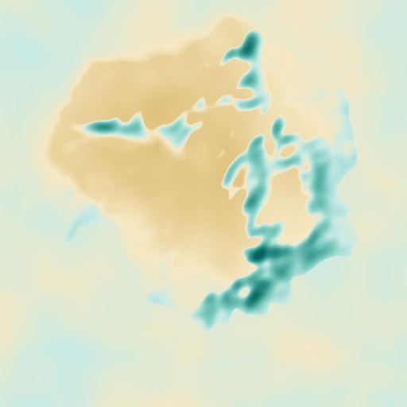

# The Unmapped

[](https://github.com/pgratz1/The-UnMapped/actions/workflows/ci.yml)

A single-player, first-person, open-world RPG whose world and history are generated from a seed. Dark high fantasy, exploration first, on flat screen and PC VR. The world generator is a headless C++20 library; the game will be a Godot 4 project whose logic lives in a C++ extension.

**This is an early-stage project.** There is no game yet. What exists today is the foundation of the world generator: a toolkit that writes reproducible world files and proves they are identical on every compiler. See [Status](#status) for exactly where things stand.

## Contents

- [The idea](#the-idea)
- [Status](#status)
- [Timeline](#timeline)
- [What works today](#what-works-today)
- [Build and run](#build-and-run)
- [How it is built to be reproducible](#how-it-is-built-to-be-reproducible)
- [Repository layout](#repository-layout)
- [How the project is developed](#how-the-project-is-developed)
- [Documents](#documents)
- [License](#license)

## The idea

A new world is generated once, from a seed. The generator builds the geography, then simulates several thousand years of history among the gods and peoples of that world: six races created in a fixed order, their civilizations, wars, migrations, monsters and ruin. Every ruin, dungeon, city, faction and quest in the playable world comes from that simulated history, so every place has a cause the player can discover.

Design pillars, in priority order:

1. **History explains the world.** Every site has a cause in the simulated past.
2. **Exploration is the reward.** Systems exist to make travelling and finding things interesting.
3. **Deterministic from the seed.** The same seed and generator version always give the same world, byte for byte.
4. **Flat screen and VR are equals.** Neither mode is a port of the other.
5. **Generator and game are separate programs.** The generator runs headless and is testable without the engine.

The project is two programs joined by one file:

```
seed + settings ──► worldgen (C++ library + CLI) ──► world.db (SQLite) ──► game (Godot 4 + C++ extension)
                    runs once per world              read-only in play     runs every session
```

The full design is in [`docs/design/design.md`](docs/design/design.md).

## Status

*Last updated: 2026-11-18.*

| | |
| --- | --- |
| **Current phase** | P3 History core, started 2026-11-19: the overview and the first three stage specs are approved; history data and settings (P3-01) and names (P3-02) are implemented and in integration, audit and validation; chronology (P3-03: awakening years, ages, creator gods, schema 6) is next. P0 Foundation, P1 Geography (reviewed and approved by Paul on 2026-11-19) and P2 Godot bring-up and viewer v0 are complete |
| **Next phase** | P4 Viewer v1 and P5 History depth, in parallel, after P3 |
| **Current milestone** | Milestone 0, Geography generator: met and approved by Paul on 2026-11-19. Now working towards milestone 1, History generator |
| **Work in flight** | P1: elevation and hydrology are merged, so `generate` writes a continent with ranges, passes, rivers and lakes. Elevation followed five rounds of design exploration and two world-critic reviews (`docs/reviews/`): irregular continents, long segmented ranges with 2,000 to 2,500 m peaks, valleys cut by erosion, and a guaranteed share of mountains in every world. Generator 0.6.0 (2026-11-17) added natural passes at saddles of each range's drainage divide, after five more exploration rounds and three critic reviews: a pass is cut by at most 500 m, so naturally low saddles become low gates and others stay high cols, and about two in five are walkable end to end at the default map size. Pass sites are stored in a `pass` table for the history simulation (the first schema change, version 2). Very steep faces are bounded by a final slope-relaxing step. Climate merged the same day (generator 0.7.0): temperature falls with height and from south to north, and each world has one prevailing wind that makes ranges wet on the windward side and dry in the lee. Biomes merged on 2026-11-18 (generator 0.8.0, schema 3): alpine, highland moor, marsh, forest and grassland by rules held as data, with forest thresholds scaled to map size; the biome definitions and the world's wind direction are stored in the world file. A variety revision merged the same day (generator 0.9.0, schema 4; Paul's decisions of 2026-11-17): heath, steppe, wet woodland along large rivers and fens on wet lowland bring the count to nine natural biomes, each world draws its own temperature offset of up to 2 °C either way (stored in the world file), and the coastal forest ring is thinner. Validated on 271 worlds; a world-critic review (`docs/reviews/p1-04b-biome-variety-critic.md`) notes two follow-ups, a visible heath stripe on some worlds and blocky fen patches on the largest maps. Resources and habitability merged on 2026-11-18 (generator 0.10.0, schema still 4): six score layers (fertility, ore, timber, fresh water, forage and habitability, each 0 to 255 and absolute, so a harsh world reads as harsh) and a layer of walkable areas, for the history simulation to place homelands, farms, mines and settlements. Habitability weighs farmland most, then wild food, timber and ore, and treats fresh water as a necessity. Validated on 271 worlds; a world-critic review (`docs/reviews/p1-05-resources-critic.md`) led to a tuning revision before the merge and records the remaining limits. Regions, the last geography stage, merged on 2026-11-19 (generator 0.11.0, schema 5): land is divided into named regions of about 2 km² each, roughly 13, 50 and 200 per map, with borders on ridge crests and large rivers, upland regions of their own for wide massifs, and placeholder names such as "Northwest Steppe II" until history renames them. Three new tables give the history simulation each region's summary (area, biomes, mean resource scores, walkable ground, reachable ore) and each border's length, lowest crossing, river and pass. A world-critic review (`docs/reviews/p1-06-regions-critic.md`) led to a revision before the merge (each pass belongs to one border; mountain and lake regions get fitting names). Validated on 271 worlds (`docs/reviews/p1-06-regions-validation.md`): a default world takes about 9 seconds and 6.5 MB. The viewer gained a regions view, a legend and a description of the cell under the mouse. Paul reviewed and approved the geography phase on 2026-11-19 and accepted the world critic's recommendations, among them the default map size (1024) as the reference size for history. P3 History core started the same day with its overview spec: the shared model of years, ages, peoples and the event log that the history stages build on. |
| **`main`** | Builds and passes all tests on Linux (GCC, Clang, Clang with sanitizers) and Windows (MSVC), in debug and release |

**What "P0 done" means.** The phase's exit check is that an empty world file is byte-identical across all three compilers and that `worldgen-cli hash` proves it in continuous integration. It does: eight test worlds, six empty and two holding test layers, are identical across all seven build configurations, and each matches its recorded golden hash. CI repeats the comparison on every push. With geography stages merged the comparison covers twelve worlds, four of them full maps with elevation and hydrology at 512 and 1024.

**Since P0 was first completed**

- Paul reviewed P0 and merged its fourteen proposals into the design document.
- Seed phrases are now scrubbed, a design change made at that review. This changed the bytes of phrase worlds, so the generator version went from 0.1.0 to 0.2.0 and all golden hashes were re-recorded: the first use of the version rule.

**Known gaps and notes**

- Geography is complete as planned: elevation, hydrology, climate, biomes, resources and regions. History does not exist yet.
- Region limitations (`docs/reviews/p1-06-regions-critic.md`): lowland borders are plain distance borders, not natural lines; some large rivers run inside a region; placeholder names repeat heavily on the largest maps (up to "Northeast Wood XXIX"); islets of any size are regions.
- Resource score limitations (`docs/reviews/p1-05-resources-critic.md`): the banks of large rivers score slightly below their hinterland, lowland areas differ little from each other, and rich ore is often on crags that cannot be reached on foot. Small maps (512) are mostly mountain and leave little room for homelands.
- Biome limitations (`docs/reviews/p1-04-biomes-critic.md`), being addressed by the revision in progress: every range has the same ring of moor on its wet and dry sides; the first kilometre of most coasts is forest; marsh is thin ribbons; rivers through grassland have bare banks.
- At the largest map size about one world in twenty has very little high ground or a peak above the intended maximum (`docs/reviews/p1-04-biomes-validation.md`, defects D1 and D2); to be fixed in elevation.
- Climate limitations (`docs/reviews/p1-03-climate-critic.md`): rainfall depends on map size (small maps are wetter); every world has the same temperature range; the wind direction is not stored yet; passes do not channel moisture.
- Known elevation limitations are listed in section 11 of the elevation spec and in `docs/reviews/p1-01b-elevation-passes-critic.md`. The main ones: low gates on small maps can cut a range down nearly to the plain; a pass sometimes erases a mountain lake on its crossing; about two in five small (512) worlds get no pass; on a rare small map a range drops into the sea as a very steep smooth face (512, seed 41); filled basins among peaks can look smooth; a few worlds get ring-shaped ranges. Rivers on gently sloping lowland run in angular steps (`docs/reviews/p1-02-hydrology-critic.md`).
- The only registered data kind is generator tuning (`game/data/worldgen/`); biomes, races and the rest come with their phases.
- The noise primitive's output stays within about two thirds of its nominal range, which is normal for this kind of noise; the P1 elevation spec needs to account for it.
- The `render` image-size limit is tested only on the "too large" side.
- The sanitizer build's test suite takes about four minutes, mostly one noise range test.
- Agent-written commits before 2026-11-15 credit "Claude Fable 5.2" although Opus subagents wrote them; later commits credit the model that wrote them.

## Timeline

The first block of work is the world generator prototype: seven phases, P0 to P6, that together deliver milestones 0 and 1 and a viewer. Game milestones 2 to 10 follow. Phases marked "parallel" can run at the same time once their dependencies are done.

### World generator prototype

| Phase | Delivers | Depends on | Status |
| --- | --- | --- | --- |
| **P0 Foundation** | Repository layout, CMake presets, vendored dependencies, CI on three compilers, the deterministic core, the reproducible SQLite layer, the TOML loader, `worldgen-cli` | — | **Done** 2026-11-15, reviewed |
| **P1 Geography** | Elevation, erosion, hydrology, climate, biomes, resources and regions, each writing its layer; image export per layer | P0 | **In progress** since 2026-11-15: first three specs approved, shared foundation, elevation and hydrology merged (2026-11-16); natural passes merged (2026-11-17, generator 0.6.0, schema 2); climate merged (2026-11-17, generator 0.7.0); biomes merged (2026-11-18, generator 0.8.0, schema 3); biome variety revision merged (2026-11-18, generator 0.9.0, schema 4); resources and habitability merged (2026-11-18, generator 0.10.0); regions merged (2026-11-19, generator 0.11.0, schema 5). **Done** 2026-11-19, reviewed and approved by Paul |
| **P2 Godot bring-up and viewer v0** | Godot version pinned, C++ extension building on Linux and Windows, `world.db` reader bound into Godot, 2D map with switchable layers | P0; parallel with P1 | **Done** 2026-11-15, awaiting Paul's hands-on review. Godot 4.7.2 and godot-cpp 10.0.0 pinned; the extension builds and its headless check passes on Linux and Windows |
| **P3 History core** | Race and culture definitions, ages and the awakening schedule, active phases and quiet intervals, civilizations, settlements, wars, ruin, the event log, a text history report | P1 | **In progress** since 2026-11-19: overview spec (seven stage specs planned) and specs P3-01 to P3-03 approved; P3-01 and P3-02 implemented, in integration and audit |
| **P4 Viewer v1** | Timeline scrubber, territory by year, settlement and site markers, browser for civilizations and events | P2, P3; parallel with P5 | Not started |
| **P5 History depth** | God interventions, beast populations, named monsters, figures and factions, race relations, casters and spellbooks | P3 | Not started |
| **P6 Derivation and polish** | Sites, dungeon records, quest hooks and spellbook placement derived from history; world-creation settings on the command line; 3D heightmap preview | P4, P5 | Not started |

```
P0 ██████████ done ──┬─► P1 Geography ██ done ──► P3 History core ──┬─► P5 History depth ──┬─► P6 Derivation
                     │                              (you are here)         │                      │
                     └─► P2 Viewer v0 ██ done ─────────────────────────────┴─► P4 Viewer v1 ──────┘
```

### Milestones

| # | Milestone | Reached when | Status |
| --- | --- | --- | --- |
| 0 | Geography generator | `worldgen-cli` writes a world with all geography layers; maps look plausible in image export and in the viewer; identical file hash on Linux and Windows | **Met**, approved by Paul 2026-11-19: all geography layers are written (P1), the viewer shows them (P2), and the file hash is identical across GCC, Clang and MSVC on Linux and Windows |
| 1 | History generator | Default history generates in under two minutes; races appear in order; the event log reads as coherent history; sites and quest hooks derived | In progress (P3 started 2026-11-19; P3 to P6) |
| 2 | Walkable terrain | Godot streams terrain from a world file; the player can cross the map on flat screen without hitches | Not started |
| 3 | VR parity | The same build starts in VR or flat; the fly-across test holds 90 Hz in VR | Not started |
| 4 | Biomes and wilderness | Six biomes with generated materials, rocks and vegetation; rivers, lakes and roads | Not started |
| 5 | Settlements | A generated city and villages with enterable interiors furnished with physics objects | Not started |
| 6 | Dungeons | Graph-based dungeons for two origin types, full of physics objects, in both modes | Not started |
| 7 | Core play | Combat, book-learned spells, skill progression, inventory, dialogue and saving in both modes | Not started |
| 8 | History in play | Quests from hooks, books and dialogue rendered from real history, local-LLM dialogue. First playable version | Not started |
| 9 | Voice dialogue | Speaking to NPCs and hearing replies, all on local models | Not started |
| 10 | Spell research | Composing, researching and casting new spells within the rules | Not started |

Milestones 0 and 1 carry the most design risk, since they decide whether generated history is interesting. Milestones 2 and 3 carry the most technical risk.

### What P0 delivered

| Stage | Spec | What it is |
| --- | --- | --- |
| Deterministic core | [`p0-01`](docs/specs/p0-01-deterministic-core.md) | One fixed-point number type (32 integer and 32 fractional bits), the project random generator (xoshiro256\*\*), seed streams derived by hashing the seed with a stage name or coordinates, integer gradient noise, integer square roots, SHA-256 |
| World database | [`p0-02`](docs/specs/p0-02-world-db.md) | A reproducible SQLite file: pinned build options, a `meta` and a `layer` table, a compact layer codec, a writer that makes the bytes independent of write order, and a read-only reader |
| TOML loader | [`p0-03`](docs/specs/p0-03-toml-loader.md) | Settings file, data-file discovery and validation in a fixed order, a content hash, and no floating point on the path to the generator |
| `worldgen-cli` | [`p0-04`](docs/specs/p0-04-worldgen-cli.md) | `generate`, `render`, `report` and `hash` |

Around them: about 300 automated test cases, 2,201 golden vectors for the core produced by an independent Python reference, a second independent Python check of world-file contents, a lint for constructs that break determinism, and a CI job that compares world hashes across every compiler.

## What works today

`worldgen-cli` writes world files and inspects them. A generated world currently holds a table of mountain passes and a table of biome definitions, the world's wind direction and temperature offset, and eleven geography layers (elevation; water, water depth, flow direction, flow accumulation, rivers, lakes and distance to the coast from hydrology; temperature and rainfall from climate; biomes) on a 512, 1024 or 2048 cell map at 16 m per cell.

```
$ worldgen-cli generate --seed-phrase "The Unmapped"
/home/you/.cache/the-unmapped/out/world-15629206466951235176.db

$ worldgen-cli report --db ~/.cache/the-unmapped/out/world-15629206466951235176.db
# worldgen report v2
[meta]
content_hash = 1543a4aef55105d5df66225432e37a7f39e50846e53741b86f084da283f9c175
format = the-unmapped-world
generator_version = 0.11.0
param.map_size = 1024
schema_version = 5
seed = 15629206466951235176
seed_phrase = the unmapped
stages = elevation,hydrology,climate,biomes,resources,regions
[tables]
biome = 12
climate = 1
layer = 19
meta = 8
pass = 3
region = 51
region_biome = 255
region_border = 126
[layers]
elevation i16 1024x1024 codec=1 bytes=1175180 min=-2306 max=19803
water u8 1024x1024 codec=1 bytes=34948 min=0 max=3
water_depth u16 1024x1024 codec=1 bytes=640156 min=0 max=2306
flow_dir u8 1024x1024 codec=1 bytes=236314 min=0 max=8
flow_accum u32 1024x1024 codec=1 bytes=468500 min=0 max=120835
river u8 1024x1024 codec=1 bytes=27457 min=0 max=8
lake u32 1024x1024 codec=1 bytes=2234 min=0 max=4
coast_dist i16 1024x1024 codec=1 bytes=1022256 min=-6579 max=5008
temperature i16 1024x1024 codec=1 bytes=274872 min=-65 max=84
rainfall u16 1024x1024 codec=1 bytes=1019690 min=497 max=4535
biome u8 1024x1024 codec=1 bytes=48513 min=1 max=12
fertility u8 1024x1024 codec=1 bytes=164027 min=0 max=255
ore u8 1024x1024 codec=1 bytes=185325 min=0 max=255
timber u8 1024x1024 codec=1 bytes=113153 min=0 max=255
fresh_water u8 1024x1024 codec=1 bytes=360860 min=0 max=255
forage u8 1024x1024 codec=1 bytes=196390 min=0 max=255
habitability u8 1024x1024 codec=1 bytes=255314 min=0 max=199
walk_area u16 1024x1024 codec=1 bytes=24902 min=0 max=2
region u16 1024x1024 codec=1 bytes=23636 min=0 max=51
[geography]
cells = 1048576
land_cells = 419430
ocean_cells = 629146
land_fraction = 0.4000
landmasses = 1
largest_landmass_share = 1.0000
coastline_m = 60320
coast_ratio = 1.6421
land_solidity = 0.8933
elevation_m = 0.1 4.3 41.8 64.2 114.9 538.2 941.0 1531.7 1980.3
depth_m = 2.9 140.8 230.6
land_above_m = 50:0.8351 500:0.2686 1000:0.0842 1500:0.0119 2000:0.0000
max_step_m = 77.2
step_p999_m = 60.8
slope_over = 35:0.3103 45:0.2163
slope_p50_above_500m = 1.1798
lowland_flat_share = 0.0162
edge_parallel_run_m = 2288
passes = 3
natural_gaps = 0
passes_capped = 1
pass_col_m = 257.8 316.7 579.4
passes_walkable = 2
lakes = 4
lake_cells = 12438
lake_share_of_land = 0.0297
largest_lake_cells = 7820
river_cells = 8370
river_share_of_land = 0.0200
river_sources = 208
river_mouths = 49
major_rivers = 15
longest_river_m = 11685
largest_basin_share = 0.2881
wind_toward = NW
temp_offset_c = -1.0
temperature_c = -6.5 -0.7 4.2 6.1 7.7
rainfall_mm = 497 553 706 1457 4535
land_below_0c = 0.1249
rain_contrast = 2.6347
biome_share = temperate_forest:0.2927 grassland:0.1449 marsh:0.0053 highland_moor:0.1038 alpine:0.1533 blighted_waste:0.0000 heath:0.0798 steppe:0.1646 wet_woodland:0.0182 fen:0.0374
biome_patches = 475
scores_p50 = fertility:72 ore:0 timber:26 fresh_water:139 forage:89 habitability:40
scores_p90 = fertility:255 ore:81 timber:255 fresh_water:235 forage:180 habitability:142
fertile_share = 0.3921
habitable_share = 0.4303
ore_rich_share = 0.0668
walk_areas = 2
walk_main_share = 0.6155
walk_share = 0.6259
regions = 51
region_area_km2 = 0.82 1.78 5.25
region_borders = 126
region_borders_walkable = 95
region_borders_river = 19
region_borders_pass = 3
regions_isolated = 0
regions_upland = 9

$ worldgen-cli hash --db ~/.cache/the-unmapped/out/world-15629206466951235176.db
816fe43fdba936f85b65f4ff8ac14c0fc3f9fed22cd17f0faac053ec61ef285f

$ worldgen-cli render --db ~/.cache/the-unmapped/out/world-15629206466951235176.db --composite map
/home/you/.cache/the-unmapped/out/world-15629206466951235176.map.png
```

That hash is the same on every supported compiler and platform, and with any number of threads. A seed phrase is scrubbed before use (lower-cased, with everything other than a to z and 0 to 9 treated as a space), so `"the-unmapped!"` and `"THE  UNMAPPED"` give this same world. The rendered map, about 16 km across with peaks near 2,000 m, three passes, four lakes and about 200 river sources:


The rainfall layer of the same world (`render --layer rainfall`): dark is wet. The prevailing wind decides which side of each range gets the rain:



The biome map (`render --composite biomes`): dark green is forest, pale green grassland, straw yellow steppe, blue-green wet woodland along the large rivers, pale teal marsh, grey-brown fen, mauve highland moor, rust brown heath and pale grey alpine ground. This world drew a temperature offset of −1.0 °C, so it is a cold one:


Habitability (`render --layer habitability`), here drawn over the relief: brighter land is better to live on. About 43% of this world's land is habitable and 63% can be walked, in two separate areas:


Regions (`render --composite regions`): the biome map with the borders of this world's 51 regions in black. Borders follow ridge crests in the mountains and large rivers in the lowlands:


A 1024 world takes about 9 seconds on six cores. `--until elevation` stops after elevation, `--until none` writes an empty world, and `--test-pattern` writes three small test layers that exercise hashing, noise and the layer codec.

| Command | Does |
| --- | --- |
| `generate` | Writes a world file from `--seed N` (decimal or `0x` hex) or `--seed-phrase TEXT` (scrubbed; a phrase is never read as a number). Options: `--out`, `--map-size 512\|1024\|2048`, `--settings FILE`, `--data DIR`, `--until STAGE\|none`, `--threads N`, `--test-pattern`, `--force` |
| `report` | Prints the metadata, row counts per table, each layer's type, size and value range, and geography statistics |
| `render` | Exports a layer as a PNG with `--layer NAME` and a palette, or a shaded relief map with `--composite map`; `--scale 1..16` |
| `hash` | Prints the SHA-256 of the file (equal to `sha256sum`). `--detail` adds separate hashes of the schema, each table and each layer, to locate a difference; `--expect HEX` checks against a known value |

Output goes under `~/.cache/the-unmapped/out/` unless `--out` says otherwise, never into the current directory. `worldgen-cli <command> --help` lists every option.

## Build and run

Requirements: CMake 3.25 or newer, Ninja, and GCC, Clang or MSVC with C++20. Everything else is vendored in [`extern/`](extern/README.md); the build never uses the network.

```
cmake --preset linux-gcc-release
cmake --build --preset linux-gcc-release
ctest --preset linux-gcc-release
```

Presets: `linux-gcc-debug`, `linux-gcc-release`, `linux-clang-debug`, `linux-clang-release`, `linux-clang-asan`, `windows-msvc-debug`, `windows-msvc-release`.

**Build output lives outside the source tree.** The build tree is `~/.cache/the-unmapped/build/<source dir name>/<preset>/` (`%LOCALAPPDATA%\the-unmapped\...` on Windows), and an in-source build is refused. The command-line tool is at `tools/worldgen-cli/worldgen-cli` inside the build tree.

Other checks:

```
python3 -B tools/lint/determinism_lint.py                              # banned-construct lint
tools/ci/world-hashes.sh local linux-gcc-release linux-clang-release   # compare world hashes across built presets
```

**The world viewer (optional).** The Godot extension is off by default, so nothing above needs Godot. To build it and open a world in the viewer:

```
tools/ci/fetch-godot.sh                                   # downloads and verifies the pinned Godot 4.7.2 editor into ~/.cache/the-unmapped/tools/
cmake --preset linux-gcc-release -DUNMAPPED_BUILD_GDEXT=ON
cmake --build --preset linux-gcc-release
B=~/.cache/the-unmapped/build/$(basename "$PWD")/linux-gcc-release
"$B/tools/worldgen-cli/worldgen-cli" generate --seed 42 --test-pattern --out ~/.cache/the-unmapped/out/seed42.db --force
~/.cache/the-unmapped/tools/godot-4.7.2-stable/Godot_v4.7.2-stable_linux.x86_64 --path "$B/game" -- ~/.cache/the-unmapped/out/seed42.db
```

The viewer lists every layer and composite view in the file in groups, shows the selected one as a map with pan and zoom beside a legend, describes the cell under the mouse (coordinates, value, biome and region name), and lists the metadata. Godot always runs on a copy of the project assembled in the build tree, never on `game/` itself.

[`CLAUDE.md`](CLAUDE.md) has the full build and test reference: every preset, the test executables and their run times, the lint, the hash comparison script and where golden values live.

## How it is built to be reproducible

"The same seed gives the same world" is a hard rule, and it means byte-identical files on Linux and Windows with GCC, Clang and MSVC. Floating-point results, standard-library random distributions and container iteration order all differ between platforms, so the generator avoids them:

- **Integer and fixed-point math only** for anything that reaches the world file. No floating point, no standard-library math functions.
- **One project random generator**, with a separate stream for each stage derived by hashing the seed with the stage's name. Anything keyed by location hashes the seed with the coordinates, so results never depend on evaluation order.
- **Fixed order everywhere.** No iteration over unordered containers, no dependence on pointer values, thread timing or the clock.
- **A reproducible database file.** SQLite is vendored at a pinned version with fixed options; the world is built in memory and written out in one step that makes the bytes depend only on the content.
- **Checked continuously.** Golden hashes are compared on every compiler in CI, and a lint rejects banned constructs.

A change that alters output bytes must bump the generator version and re-record the golden values in the same change.

## Repository layout

```
worldgen/     C++ library with no engine dependencies
  include/    public headers: core, db, data, stages, inspect
  src/        core (fixed point, random, hashing, noise), db, data, stages, inspect
  tests/      doctest tests, golden values, and the independent Python references
tools/
  worldgen-cli/   the command-line tool and its integration tests
  lint/           the determinism lint
  ci/             the cross-compiler world hash script
gdext/        C++ GDExtension for Godot: world reader binding and the viewer's logic
game/         Godot project: the world viewer scene (layout only, no scripts)
extern/       vendored third-party libraries at pinned versions
docs/
  design/     the design document and proposals for changing it
  specs/      one approved spec per generator stage
  reviews/    world critic reviews (from P1 on)
```

Vendored libraries: SQLite 3.54.1, doctest 2.5.3, toml++ 3.4.0, stb_image_write 1.18 and godot-cpp 10.0.0 (used only when the Godot extension is built). Versions, sources, licenses and checksums are in [`extern/README.md`](extern/README.md).

## How the project is developed

The code is written by Claude Code agents with narrow roles, coordinated by a lead session and directed by Paul. Separating the roles that write code from the roles that test and judge it keeps a stage from grading itself.

| Role | Does |
| --- | --- |
| Lead | Breaks each phase into stage tasks, assigns them, approves specs, merges finished work |
| Spec writer | Turns a design section into an exact stage spec |
| Generator engineer | Implements one stage from its spec |
| Test writer | Writes the stage's tests from the spec, without reading the implementation first |
| Determinism auditor | Reviews every change for anything that could differ by compiler or platform; owns the lint |
| Validation specialist | Builds every preset, runs seed sweeps, verifies content independently, records golden values |
| World critic | Judges generated maps and histories against the design (from P1 on) |
| Viewer engineer | Builds the Godot extension and the world viewer (from P2 on) |
| Build engineer | Owns CMake, vendored dependencies and CI |

A stage moves through them in order: spec, then implementation and tests written separately, then the determinism audit, then validation, then merge. The merge gate is that tests pass on every build preset, golden hashes are recorded and match across platforms, and the audit passes. Each phase ends with a human review.

In P0 this process caught, before anything reached `main`: a rolled-back stage leaving a gap in layer ids, a Windows-only path where a failed file rename could report success, a case where a failed write to standard output exited with success, and a TOML parser setting that gave different error lists on different compilers.

The role definitions are in [`.claude/agents/`](.claude/agents), and the working rules are in [`CLAUDE.md`](CLAUDE.md).

## Documents

| Document | What it is |
| --- | --- |
| [`docs/design/design.md`](docs/design/design.md) | The design document: the specification for the whole project. Exported from a working document and read-only in this repository |
| [`docs/design/proposals.md`](docs/design/proposals.md) | Proposed changes, open questions and findings to carry back to the design |
| [`docs/specs/`](docs/specs) | The approved spec for each generator stage, with amendments made during implementation |
| [`CLAUDE.md`](CLAUDE.md) | Hard rules, how work is organized, and the build and test reference |
| [`tools/lint/README.md`](tools/lint/README.md) | The determinism lint's rules |
| [`worldgen/tests/reference/README.md`](worldgen/tests/reference/README.md) | The independent Python references and how to regenerate golden vectors |

## License

[MIT](LICENSE). Vendored libraries keep their own licenses, listed in [`extern/README.md`](extern/README.md).
