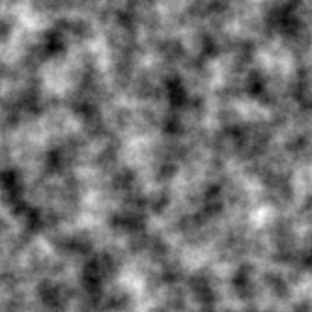

# The Unmapped

[](https://github.com/pgratz1/The-UnMapped/actions/workflows/ci.yml)

A single-player, first-person, open-world RPG whose world and history are generated from a seed. Dark high fantasy, exploration first, on flat screen and PC VR. The world generator is a headless C++20 library; the game will be a Godot 4 project whose logic lives in a C++ extension.

**This is an early-stage project.** There is no game yet. What exists today is the foundation of the world generator: a toolkit that writes reproducible world files and proves they are identical on every compiler. See [Status](#status) for exactly where things stand.

## Contents

- [The idea](#the-idea)
- [Status](#status)
- [Timeline](#timeline)
- [What works today](#what-works-today)
- [Build and run](#build-and-run)
- [How it is built to be reproducible](#how-it-is-built-to-be-reproducible)
- [Repository layout](#repository-layout)
- [How the project is developed](#how-the-project-is-developed)
- [Documents](#documents)
- [License](#license)

## The idea

A new world is generated once, from a seed. The generator builds the geography, then simulates several thousand years of history among the gods and peoples of that world: six races created in a fixed order, their civilizations, wars, migrations, monsters and ruin. Every ruin, dungeon, city, faction and quest in the playable world comes from that simulated history, so every place has a cause the player can discover.

Design pillars, in priority order:

1. **History explains the world.** Every site has a cause in the simulated past.
2. **Exploration is the reward.** Systems exist to make travelling and finding things interesting.
3. **Deterministic from the seed.** The same seed and generator version always give the same world, byte for byte.
4. **Flat screen and VR are equals.** Neither mode is a port of the other.
5. **Generator and game are separate programs.** The generator runs headless and is testable without the engine.

The project is two programs joined by one file:

```
seed + settings ──► worldgen (C++ library + CLI) ──► world.db (SQLite) ──► game (Godot 4 + C++ extension)
                    runs once per world              read-only in play     runs every session
```

The full design is in [`docs/design/design.md`](docs/design/design.md).

## Status

*Last updated: 2026-11-15.*

| | |
| --- | --- |
| **Current phase** | P0 Foundation: implemented and merged, awaiting Paul's end-of-phase review |
| **Next phase** | P1 Geography, in parallel with P2 Godot bring-up and viewer |
| **Current milestone** | Milestone 0, Geography generator: not yet reached (needs P1 and P2) |
| **Work in flight** | None. No agents are running and no branches are unmerged. |
| **`main`** | Builds and passes all tests on Linux (GCC, Clang, Clang with sanitizers) and Windows (MSVC), in debug and release |

**What "P0 done" means.** The phase's exit check is that an empty world file is byte-identical across all three compilers and that `worldgen-cli hash` proves it in continuous integration. It does: eight test worlds, six empty and two holding test layers, are identical across all seven build configurations, and each matches its recorded golden hash. CI repeats the comparison on every push.

**Open before P1 starts**

- Paul's review of P0 (each phase ends with one).
- Fourteen entries in [`docs/design/proposals.md`](docs/design/proposals.md) recording decisions and findings from P0 are waiting to be carried back into the design document. All are marked open; none blocks P1.

**Known gaps and notes from P0**

- No geography of any kind exists yet. `--map-size` is recorded in the world file but nothing generates at that size.
- The TOML loader's machinery is complete and tested, but no real data kinds (biomes, races and so on) are registered, so `--data` reads nothing.
- The noise primitive's output stays within about two thirds of its nominal range, which is normal for this kind of noise; the P1 elevation spec needs to account for it.
- The `render` image-size limit is tested only on the "too large" side.
- The sanitizer build's test suite takes about four minutes, mostly one noise range test.
- Agent-written commits before 2026-11-15 credit "Claude Fable 5.2" although Opus subagents wrote them; later commits credit the model that wrote them.

## Timeline

The first block of work is the world generator prototype: seven phases, P0 to P6, that together deliver milestones 0 and 1 and a viewer. Game milestones 2 to 10 follow. Phases marked "parallel" can run at the same time once their dependencies are done.

### World generator prototype

| Phase | Delivers | Depends on | Status |
| --- | --- | --- | --- |
| **P0 Foundation** | Repository layout, CMake presets, vendored dependencies, CI on three compilers, the deterministic core, the reproducible SQLite layer, the TOML loader, `worldgen-cli` | — | **Done** 2026-11-15, awaiting review |
| **P1 Geography** | Elevation, erosion, hydrology, climate, biomes, resources and regions, each writing its layer; image export per layer | P0 | **Next.** Not started |
| **P2 Godot bring-up and viewer v0** | Godot version pinned, C++ extension building on Linux and Windows, `world.db` reader bound into Godot, 2D map with switchable layers | P0; parallel with P1 | Not started |
| **P3 History core** | Race and culture definitions, ages and the awakening schedule, active phases and quiet intervals, civilizations, settlements, wars, ruin, the event log, a text history report | P1 | Not started |
| **P4 Viewer v1** | Timeline scrubber, territory by year, settlement and site markers, browser for civilizations and events | P2, P3; parallel with P5 | Not started |
| **P5 History depth** | God interventions, beast populations, named monsters, figures and factions, race relations, casters and spellbooks | P3 | Not started |
| **P6 Derivation and polish** | Sites, dungeon records, quest hooks and spellbook placement derived from history; world-creation settings on the command line; 3D heightmap preview | P4, P5 | Not started |

```
P0 ██████████ done ──┬─► P1 Geography ──► P3 History core ──┬─► P5 History depth ──┬─► P6 Derivation
   (you are here)    └─► P2 Viewer v0 ─────────────────────┴─► P4 Viewer v1 ──────┘
```

### Milestones

| # | Milestone | Reached when | Status |
| --- | --- | --- | --- |
| 0 | Geography generator | `worldgen-cli` writes a world with all geography layers; maps look plausible in image export and in the viewer; identical file hash on Linux and Windows | In progress: foundation done (P0); needs P1 and P2 |
| 1 | History generator | Default history generates in under two minutes; races appear in order; the event log reads as coherent history; sites and quest hooks derived | Not started (P3 to P6) |
| 2 | Walkable terrain | Godot streams terrain from a world file; the player can cross the map on flat screen without hitches | Not started |
| 3 | VR parity | The same build starts in VR or flat; the fly-across test holds 90 Hz in VR | Not started |
| 4 | Biomes and wilderness | Six biomes with generated materials, rocks and vegetation; rivers, lakes and roads | Not started |
| 5 | Settlements | A generated city and villages with enterable interiors furnished with physics objects | Not started |
| 6 | Dungeons | Graph-based dungeons for two origin types, full of physics objects, in both modes | Not started |
| 7 | Core play | Combat, book-learned spells, skill progression, inventory, dialogue and saving in both modes | Not started |
| 8 | History in play | Quests from hooks, books and dialogue rendered from real history, local-LLM dialogue. First playable version | Not started |
| 9 | Voice dialogue | Speaking to NPCs and hearing replies, all on local models | Not started |
| 10 | Spell research | Composing, researching and casting new spells within the rules | Not started |

Milestones 0 and 1 carry the most design risk, since they decide whether generated history is interesting. Milestones 2 and 3 carry the most technical risk.

### What P0 delivered

| Stage | Spec | What it is |
| --- | --- | --- |
| Deterministic core | [`p0-01`](docs/specs/p0-01-deterministic-core.md) | One fixed-point number type (32 integer and 32 fractional bits), the project random generator (xoshiro256\*\*), seed streams derived by hashing the seed with a stage name or coordinates, integer gradient noise, integer square roots, SHA-256 |
| World database | [`p0-02`](docs/specs/p0-02-world-db.md) | A reproducible SQLite file: pinned build options, a `meta` and a `layer` table, a compact layer codec, a writer that makes the bytes independent of write order, and a read-only reader |
| TOML loader | [`p0-03`](docs/specs/p0-03-toml-loader.md) | Settings file, data-file discovery and validation in a fixed order, a content hash, and no floating point on the path to the generator |
| `worldgen-cli` | [`p0-04`](docs/specs/p0-04-worldgen-cli.md) | `generate`, `render`, `report` and `hash` |

Around them: about 290 automated test cases, 1,458 golden vectors for the core produced by an independent Python reference, a second independent Python check of world-file contents, a lint for constructs that break determinism, and a CI job that compares world hashes across every compiler.

## What works today

`worldgen-cli` writes world files and inspects them. A world is currently either empty (metadata only) or, with `--test-pattern`, holds three 256 × 256 test layers that exercise hashing, noise and the layer codec.

```
$ worldgen-cli generate --seed-phrase "The Unmapped" --test-pattern
/home/you/.cache/the-unmapped/out/world-8180607403873905586.db

$ worldgen-cli report --db ~/.cache/the-unmapped/out/world-8180607403873905586.db
# worldgen report v1
[meta]
content_hash = e3b0c44298fc1c149afbf4c8996fb92427ae41e4649b934ca495991b7852b855
format = the-unmapped-world
generator_version = 0.2.0
param.map_size = 1024
schema_version = 1
seed = 8180607403873905586
seed_phrase = The Unmapped
stages = test_pattern
[tables]
layer = 3
meta = 8
[layers]
test.ramp u8 256x256 codec=1 bytes=65818 min=0 max=255
test.hash u8 256x256 codec=1 bytes=102422 min=0 max=255
test.noise i16 256x256 codec=1 bytes=127532 min=-15532 max=18925

$ worldgen-cli hash --db ~/.cache/the-unmapped/out/world-8180607403873905586.db
a8b3564285525c648c92290fd1d500602c6ad06cc591b62fb833aa52c9f31c10

$ worldgen-cli render --db ~/.cache/the-unmapped/out/world-8180607403873905586.db --layer test.noise --scale 2
/home/you/.cache/the-unmapped/out/world-8180607403873905586.test.noise.png
```

That hash is the same on every supported compiler and platform. The rendered noise layer, the raw material P1's elevation stage will shape into a continent:



| Command | Does |
| --- | --- |
| `generate` | Writes a world file from `--seed N` (decimal or `0x` hex) or `--seed-phrase TEXT`. Options: `--out`, `--map-size 512\|1024\|2048`, `--settings FILE`, `--data DIR`, `--test-pattern`, `--force` |
| `report` | Prints the metadata, row counts per table, and each layer's type, size and value range |
| `render` | Exports a layer as a grayscale PNG, with `--scale 1..16` |
| `hash` | Prints the SHA-256 of the file (equal to `sha256sum`). `--detail` adds separate hashes of the schema, each table and each layer, to locate a difference; `--expect HEX` checks against a known value |

Output goes under `~/.cache/the-unmapped/out/` unless `--out` says otherwise, never into the current directory. `worldgen-cli <command> --help` lists every option.

## Build and run

Requirements: CMake 3.25 or newer, Ninja, and GCC, Clang or MSVC with C++20. Everything else is vendored in [`extern/`](extern/README.md); the build never uses the network.

```
cmake --preset linux-gcc-release
cmake --build --preset linux-gcc-release
ctest --preset linux-gcc-release
```

Presets: `linux-gcc-debug`, `linux-gcc-release`, `linux-clang-debug`, `linux-clang-release`, `linux-clang-asan`, `windows-msvc-debug`, `windows-msvc-release`.

**Build output lives outside the source tree.** The build tree is `~/.cache/the-unmapped/build/<source dir name>/<preset>/` (`%LOCALAPPDATA%\the-unmapped\...` on Windows), and an in-source build is refused. The command-line tool is at `tools/worldgen-cli/worldgen-cli` inside the build tree.

Other checks:

```
python3 -B tools/lint/determinism_lint.py                              # banned-construct lint
tools/ci/world-hashes.sh local linux-gcc-release linux-clang-release   # compare world hashes across built presets
```

[`CLAUDE.md`](CLAUDE.md) has the full build and test reference: every preset, the test executables and their run times, the lint, the hash comparison script and where golden values live.

## How it is built to be reproducible

"The same seed gives the same world" is a hard rule, and it means byte-identical files on Linux and Windows with GCC, Clang and MSVC. Floating-point results, standard-library random distributions and container iteration order all differ between platforms, so the generator avoids them:

- **Integer and fixed-point math only** for anything that reaches the world file. No floating point, no standard-library math functions.
- **One project random generator**, with a separate stream for each stage derived by hashing the seed with the stage's name. Anything keyed by location hashes the seed with the coordinates, so results never depend on evaluation order.
- **Fixed order everywhere.** No iteration over unordered containers, no dependence on pointer values, thread timing or the clock.
- **A reproducible database file.** SQLite is vendored at a pinned version with fixed options; the world is built in memory and written out in one step that makes the bytes depend only on the content.
- **Checked continuously.** Golden hashes are compared on every compiler in CI, and a lint rejects banned constructs.

A change that alters output bytes must bump the generator version and re-record the golden values in the same change.

## Repository layout

```
worldgen/     C++ library with no engine dependencies
  include/    public headers: core, db, data, stages, inspect
  src/        core (fixed point, random, hashing, noise), db, data, stages, inspect
  tests/      doctest tests, golden values, and the independent Python references
tools/
  worldgen-cli/   the command-line tool and its integration tests
  lint/           the determinism lint
  ci/             the cross-compiler world hash script
gdext/        C++ GDExtension for Godot (placeholder until P2)
game/         Godot project (placeholder until P2)
extern/       vendored third-party libraries at pinned versions
docs/
  design/     the design document and proposals for changing it
  specs/      one approved spec per generator stage
  reviews/    world critic reviews (from P1 on)
```

Vendored libraries: SQLite 3.54.1, doctest 2.5.3, toml++ 3.4.0 and stb_image_write 1.18. Versions, sources, licenses and checksums are in [`extern/README.md`](extern/README.md).

## How the project is developed

The code is written by Claude Code agents with narrow roles, coordinated by a lead session and directed by Paul. Separating the roles that write code from the roles that test and judge it keeps a stage from grading itself.

| Role | Does |
| --- | --- |
| Lead | Breaks each phase into stage tasks, assigns them, approves specs, merges finished work |
| Spec writer | Turns a design section into an exact stage spec |
| Generator engineer | Implements one stage from its spec |
| Test writer | Writes the stage's tests from the spec, without reading the implementation first |
| Determinism auditor | Reviews every change for anything that could differ by compiler or platform; owns the lint |
| Validation specialist | Builds every preset, runs seed sweeps, verifies content independently, records golden values |
| World critic | Judges generated maps and histories against the design (from P1 on) |
| Viewer engineer | Builds the Godot extension and the world viewer (from P2 on) |
| Build engineer | Owns CMake, vendored dependencies and CI |

A stage moves through them in order: spec, then implementation and tests written separately, then the determinism audit, then validation, then merge. The merge gate is that tests pass on every build preset, golden hashes are recorded and match across platforms, and the audit passes. Each phase ends with a human review.

In P0 this process caught, before anything reached `main`: a rolled-back stage leaving a gap in layer ids, a Windows-only path where a failed file rename could report success, a case where a failed write to standard output exited with success, and a TOML parser setting that gave different error lists on different compilers.

The role definitions are in [`.claude/agents/`](.claude/agents), and the working rules are in [`CLAUDE.md`](CLAUDE.md).

## Documents

| Document | What it is |
| --- | --- |
| [`docs/design/design.md`](docs/design/design.md) | The design document: the specification for the whole project. Exported from a working document and read-only in this repository |
| [`docs/design/proposals.md`](docs/design/proposals.md) | Proposed changes, open questions and findings to carry back to the design |
| [`docs/specs/`](docs/specs) | The approved spec for each generator stage, with amendments made during implementation |
| [`CLAUDE.md`](CLAUDE.md) | Hard rules, how work is organized, and the build and test reference |
| [`tools/lint/README.md`](tools/lint/README.md) | The determinism lint's rules |
| [`worldgen/tests/reference/README.md`](worldgen/tests/reference/README.md) | The independent Python references and how to regenerate golden vectors |

## License

[MIT](LICENSE). Vendored libraries keep their own licenses, listed in [`extern/README.md`](extern/README.md).
