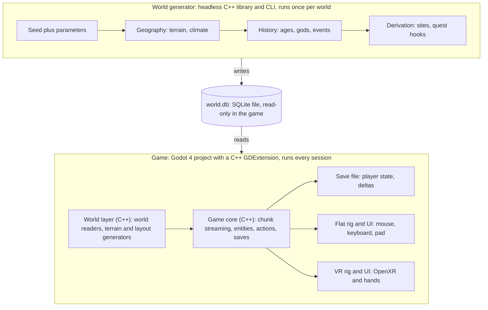

# The Unmapped — Design Doc

Nov 14, 2026 · @Paul V. Gratz

## 1. Overview and pillars

The Unmapped is a single-player, first-person, open-world RPG whose world and history are generated from a seed. The tone is dark high fantasy and the core activity is exploration. It runs on flat screen and in VR from the first milestone.

A new world is generated once, in a dedicated "create world" phase. The generator builds geography, then simulates millennia of history among the gods and peoples of that world. Ruins, dungeons, cities, factions and quests all come from that simulated history. Later play sessions load the saved world.

Design pillars, in priority order:

1. **History explains the world.** Every site has a cause in the simulated past, and the player can discover it.
2. **Exploration is the reward.** Systems exist to make travelling and finding things interesting.
3. **Deterministic from the seed.** The same seed and generator version always give the same world.
4. **Flat and VR are equals.** Neither mode is a port of the other.
5. **Generator and game are separate programs.** The generator runs headless and is testable without the engine.

**Art direction.** The look is grounded, semi-realistic high fantasy in the manner of Oblivion and Skyrim, with all assets original or openly licensed.

- **Characters and creatures.** Naturalistic proportions and materials. The six races read as distinct peoples through build, face and dress.
- **Architecture.** Weathered medieval building, with a recognisable style per race and culture so a ruin's makers can be read from its stones.
- **Landscape.** Natural terrain, dense vegetation and weather. The dark tone comes from a muted palette, low light, fog and decay.
- **Materials and light.** Physically based materials, realistic lighting, and real darkness in dungeons where torches and light spells matter.
- **Interface.** Restrained and parchment-toned, staying out of the way of the world.

This style costs more than a stylized one in texture memory, vegetation and character work, so the VR budget in section 8 sets hard limits on it. Assets are generated by code wherever possible (section 7), and greybox art carries the project until each generator is good enough.

## 2. Scope

The first playable version is a vertical slice: one generated world you can walk across in both modes, with one of each major content type. Breadth comes later.

| Area | In the first playable version | Deferred |
| --- | --- | --- |
| World | One continent, 16 km on a side by default and user-set at world creation, 6 biomes | Multiple continents, oceans to sail, seasons |
| History | 6,000 years by default, simulated in active phases with quiet intervals; six races created by the gods in a fixed order, plus beasts and monsters; wars, migrations, settlement founding and ruin | Mortal religions and temples, trade economy, dynasties in depth, artifacts with lineages, history mode |
| Sites | Cities, villages, ruins, and dungeons placed by history; interiors and dungeons filled with physics objects | Underground realms, megastructures |
| Play | Walk, fight, cast fixed spells learned from books, loot, level up, read the world's history, and talk to NPCs in text with a local LLM phrasing their lines | Spell research, voice dialogue, crafting, companions, player housing |
| Quests | Template quests instantiated from historical facts | Multi-stage story arcs, faction reputation |
| Platforms | Linux and Windows desktop, PC VR through OpenXR | Steam Deck tuning |
| Assets | Generated assets wherever a generator exists; greybox and CC0 placeholders elsewhere | Final art in the chosen semi-realistic style, audio, music |

Non-goals for the whole project, unless revisited: multiplayer, infinite worlds, standalone VR headsets, and voxel or destructible terrain.

## 3. Architecture

The project is two programs joined by one file. A headless generator turns a seed into `world.db`, and the Godot game reads that file every session.



The generator runs once per world and never links against the engine. The game never writes to `world.db`; player changes go to a save file.

Why the split:

- The generator can run thousands of seeds from the command line for tuning and regression tests.
- Determinism is checked by hashing the output file, with no engine in the loop.
- The history model, the hardest design problem, stays portable if the engine ever changes.
- The same C++ library is linked twice: into the CLI for generation, and into the GDExtension for reading the world and realizing chunks, cities and dungeons at runtime.

## 4. World generation: geography

Geography is generated first, as a stack of coarse raster maps that later stages read. The default world map is 1024 x 1024 cells at 16 m per cell, about 16.4 km on a side. Map size is a world-creation setting.

**Scale is compressed.** The map stands for a larger land, in the manner of the Elder Scrolls games. The history simulation counts abstract populations and armies (a city of 20,000, a host of 3,000), and the playable world shows a scaled-down version of each (a few dozen buildings, a few dozen soldiers). Distances are symbolic: a day's walk in play may stand for a week's march in history. The database stores the simulated figures; the runtime applies a per-settlement-kind scale rule.

Stages run in a fixed order, and each writes its layer to the world database:

1. **Elevation.** Layered noise shaped by a continent mask, then hydraulic erosion.
2. **Hydrology.** Flow accumulation gives rivers and lakes; sea level sets the coast.
3. **Climate.** Temperature from latitude and elevation; rainfall from prevailing wind and rain shadow.
4. **Biomes.** A lookup on temperature and rainfall, plus special cases for coast, river and high peaks.
5. **Resources and habitability.** Per-cell scores for fertility, ore, timber and fresh water. The history simulation uses these to place peoples.
6. **Regions.** Cells are grouped into named regions of a few square kilometres, the unit the history simulation reasons about.

Starting biomes: temperate forest, grassland, marsh, highland moor, alpine, and blighted waste. The waste is a history output: it marks land ruined by past events.

Determinism rules for every stage:

- One 64-bit world seed. Each stage derives its own stream by hashing the seed with a stage name.
- Anything keyed by location hashes the seed with the coordinates, so results never depend on evaluation order.
- The same seed, parameters and generator version must give a byte-identical world file on every supported platform and compiler.
- The database records the generator version. A world is only guaranteed reproducible under the same version. The version is a hand-bumped MAJOR.MINOR.PATCH constant, raised by any change to output bytes, with golden hashes re-recorded in the same change. Upgrading the vendored SQLite counts as such a change.

Rules that make bit-identical output achievable:

- **Integer and fixed-point math** for everything that reaches the database, in both geography and history. Noise, erosion and climate use fixed-point or integer formulations.
- **No platform math in the output path.** Standard-library transcendental functions and random distributions differ between platforms, so the generator carries its own.
- **Own random generator.** One specified integer algorithm, with all sampling written in the project.
- **Fixed order everywhere.** No iteration over unordered containers, no dependence on pointer values or thread timing. Parallel work is split and merged in a fixed order.
- **Controlled compilation.** No fast-math flags, and floating point is kept out of generator results.
- **Reproducible database file.** SQLite is vendored at a pinned version with fixed page size and settings, rows are written in a defined order, and no timestamps are stored.
- **Tested continuously.** Golden-seed hashes are compared on Linux and Windows, with GCC, Clang and MSVC, in continuous integration.

Choices made in phase P0, specified exactly in `docs/specs/p0-01` to `p0-04`:

- **Fixed point.** One Q32.32 type, rounding half away from zero, with overflow treated as a fatal error.
- **Random numbers.** xoshiro256\*\* seeded through SplitMix64.
- **Streams and location keys.** SplitMix64-based hashing with domain tags.
- **Noise.** 2D integer gradient noise.
- **Hashes.** A project SHA-256 for file and content hashes.
- **Deferred to P1.** Sine, cosine, exponential and similar functions, written in fixed point when geography needs them.
- **Writing the file.** The world is built in memory and written with SQLite `VACUUM INTO`, which makes the file's bytes independent of write order.
- **No floating point in the database.** Enforced by never binding a floating-point value and by a `typeof` check. STRICT tables alone are not enough, since they accept a lossless real value.
- **Seed phrases.** A phrase is trimmed of ASCII whitespace, taken as UTF-8 bytes and hashed with a domain tag. Case and Unicode form are significant for now, and the phrase is stored in `meta`.

## 5. History simulation

History is an agent-based simulation over the finished geography that spans millennia and writes an event log. It simulates the eventful periods in yearly ticks and summarizes the quiet stretches between them. The log is the primary product; current world state is what remains after the last tick.

**Deep time: ages, active phases and quiet intervals**

The default history spans 6,000 years, of which roughly 1,200 are simulated in detail. That keeps generation fast while letting the oldest civilizations be truly ancient.

- **Ages.** History is divided into six ages, one per race. Each age opens when the gods bring a new race into the world.
- **Active phases.** Each age begins with an active phase of yearly ticks: the new race settles, meets its neighbours, and the first wars and alliances form. A final active phase runs up to the present day.
- **Quiet intervals.** Between active phases, a coarse step advances the world in one jump. Populations drift toward what the land supports, ruling lines turn over as a count of generations, ruins decay, and long-lived figures and monsters simply persist.
- **Flare-ups.** A quiet interval can be interrupted. If a tension measure crosses a threshold (two expanding borders meet, a monster wakes, a god acts), a short active phase is inserted.
- **Records.** Quiet intervals write only a few summary events, such as "four centuries of peace under the same dynasty". Active phases write the detailed log.
- **Determinism.** The schedule of phases is derived from the seed and the world state, so the same seed gives the same history.

**Gods and the order of the races**

A pantheon of gods in three camps (good, neutral, evil) creates the races and keeps acting on the world. The order in which races appear is fixed in every world. The seed varies the dates, the places and the gods' names.

| Order | Race | Created by | Character | Consequence in history |
| --- | --- | --- | --- | --- |
| 1 | Elves | Good gods | Very long-lived, few in number | Their civilizations rise first and are the oldest in the present day |
| 2 | Goblins | Evil gods | Short-lived, numerous | Made in opposition to the elves; hostile to them from the first year |
| 3 | Dwarves | Neutral gods | Long-lived, mountain dwellers | Arrive into a world already at war; build in places the others avoid |
| 4 | Faeries | Good gods | Small, pixie-like humanoids; long-lived | Hidden communities in wild places; allies of the elves by origin |
| 5 | Humans | Neutral gods | Short-lived, adaptable, fast-growing | Spread quickly over land left open or ruined by older wars |
| 6 | Orcs | Evil gods | Strong, warlike | The last arrivals; their coming opens the most recent age of conflict |

The timing is uneven by design. The elves have the world to themselves for about the first third of history, and each later race arrives sooner after the one before. The seed shifts each date by a small amount and never changes the order.

| Race | Awakening, as a share of the span | With the 6,000-year default |
| --- | --- | --- |
| Elves | 0% | Year 0 |
| Goblins | About 35% | Around year 2,100 |
| Dwarves | About 55% | Around year 3,300 |
| Faeries | About 70% | Around year 4,200 |
| Humans | About 83% | Around year 5,000 |
| Orcs | About 93% | Around year 5,600 |

How the gods act:

- **Creation.** Each race's awakening is an event with a god, a year and a place, chosen to suit that race's preferred land.
- **Intervention.** During active phases gods can bless or curse a people, raise a champion, send a monster, or mark a site as sacred or profane. Each act is an event with causes and consequences like any other.
- **Alignment sets starting relations.** Races made by the same camp begin friendly, opposed camps begin hostile, and neutral races begin wary of both. History then moves these.
- **Present day.** The gods are part of what NPCs know and argue about. Whether gods act during play is an open question.

**World-creation settings**

The "create world" screen exposes these, each with a default. All are stored in `meta` so a world can be regenerated.

| Setting | Default | Range for the first version |
| --- | --- | --- |
| Seed | Random | Any 64-bit value or a text phrase |
| Map size | 16 km on a side | 8, 16 or 32 km |
| History span | 6,000 years | 2,000 to 12,000 years |
| History detail | About 1,200 simulated years | Sparse, normal, dense (sets active-phase length and flare-up threshold) |
| Civilizations per race | 1 to 2, chosen from the seed | 1 to 4 |
| Races present | All six | Any subset; the order of appearance never changes |
| Monster pressure | Normal | Low, normal, high |
| Divine activity | Normal | Distant, normal, meddling |
| Event intensity | Normal | Calm, normal, turbulent |

**Entities**

- **Civilizations**: a society of one race, or a mix, with a culture template, values, a home region and relations to other civilizations.
- **Settlements**: hamlets, villages, towns, cities and fortresses, each with population, owner, founding year and status (thriving, declining, ruined).
- **Figures**: named individuals such as rulers, generals, heroes, outlaws and monsters, with birth and death years and ties to each other.
- **Factions**: groups inside or across civilizations, such as noble houses, cults, bandit bands and orders.
- **Sites**: non-settlement places such as battlefields, tombs, shrines, lairs and mines.
- **Events**: typed records with a year, a location, participants and causes that point to earlier events.

**Peoples, beasts and monsters**

The world holds three kinds of living things, and all three act in history and appear in play. Every kind is defined in data files, so the roster can grow without code changes.

| Kind | Starting roster | Role in history | Role in play |
| --- | --- | --- | --- |
| Races | Elves, goblins, dwarves, faeries, humans, orcs | Form civilizations and factions; each has preferred biomes, lifespan, temperament and stances toward the others | Townsfolk, traders, quest givers, soldiers, bandits, enemies |
| Beasts | Wolves, bears, boar, deer, giant spiders | Populations per region that rise and fall with habitat; they limit settlement growth and feed it through hunting | Wildlife, prey and wilderness threats, placed by biome and regional population |
| Monsters | Trolls, ogres, giants, undead, wyverns, dragons | Rare named or grouped actors that raid, claim lairs, destroy settlements and are sometimes slain by heroes | Dungeon and lair inhabitants; named monsters carry their history into the encounter |

Interaction rules the simulation needs:

- **Race relations.** Each pair of races has a starting disposition that events move over time. Old wars leave grudges that shape later choices.
- **Mixed settlements.** Conquest, trade and migration can leave a settlement with several races, each with its own standing there.
- **Monsters as actors.** A named monster has a lair, a territory, a hoard and a kill list. Its death or survival is a historical event.
- **Beasts as pressure.** Beast populations are counts per region. High predator counts slow settlement growth and spawn events such as attacks on travellers.
- **Undead from history.** Undead arise at sites with enough violent death or broken burial rites, which ties them to specific past events.

**Magic in history.** Some figures are casters. They found towers and libraries, invent named spells, write the spellbooks the player later finds, and sometimes cause disasters such as a blight. Each race has leanings toward certain schools, which shapes where each kind of magic is found.

**Tick loop (active phases)**

1. Settlements grow or shrink from local resources and recent events.
2. Civilizations act on goals: found a settlement, build a road, claim a region, declare war, sue for peace.
3. Figures are born, rise, act on ambitions and die.
4. Random pressures fire with seeded probability: plague, famine, monster incursion, succession crisis, blight.
5. Consequences resolve: battles, sieges, sackings, migrations, abandonments.
6. Every change is appended to the event log with links to its causes.

**From history to play**

A final pass turns the end state and the log into things the player meets:

- **Points of interest.** A sacked town becomes a ruin; a battle leaves a battlefield and barrows; a dead ruler gets a tomb; a monster's lair persists until someone in history kills it.
- **Dungeons.** Each dungeon has an origin type from its history (tomb, mine, fallen fortress, cult sanctum, lair), which selects its layout rules and inhabitants.
- **Quest hooks.** Unresolved tensions in the end state become quest templates: a stolen heirloom never recovered, an heir in exile, a lair near a village, a lost expedition.
- **Lore.** Books, inscriptions and dialogue are rendered from event records, so what the player reads is true of that world.

The simulation runs to the target year and then stops; the world is frozen during play. A later "history mode" could resume the simulation from the player's present, with the player's deeds added to the event log as real history. To keep that door open, player actions that matter (a monster slain, a ruler killed, a town saved) are recorded in the save file using the same event format as the generator.

## 6. World database

A world is one SQLite file, `world.db`, and its schema is the contract between the generator and the game. The game opens it read-only. Player changes live in a separate save file.

| Table | Holds | Key columns |
| --- | --- | --- |
| `meta` | Seed, generator version, schema version, parameters, end year | `key`, `value` |
| `layer` | Raster maps stored as compressed blobs | `name`, `width`, `height`, `format`, `data` |
| `region` | Named regions and their summary stats | `id`, `name`, `biome`, `bounds` |
| `civilization` | Peoples and culture parameters | `id`, `name`, `culture`, `home_region` |
| `settlement` | Cities, villages, forts and their state | `id`, `name`, `kind`, `civ_id`, `x`, `y`, `founded`, `status`, `population` |
| `figure` | Named individuals | `id`, `name`, `civ_id`, `born`, `died`, `role` |
| `faction` | Groups and their allegiance | `id`, `name`, `kind`, `civ_id` |
| `site` | Ruins, tombs, lairs, battlefields, dungeons | `id`, `name`, `kind`, `x`, `y`, `origin_event`, `layout_seed` |
| `event` | The history log | `id`, `year`, `type`, `region_id`, `site_id`, `summary` |
| `event_participant` | Who took part in an event and how | `event_id`, `entity_type`, `entity_id`, `role` |
| `event_cause` | Links from an event to its causes | `event_id`, `cause_event_id` |
| `relation` | Ties between figures, factions and civilizations | `a_type`, `a_id`, `b_type`, `b_id`, `kind`, `since` |
| `road` | Road and trail polylines between settlements | `id`, `kind`, `points` |
| `quest_hook` | Quest templates bound to specific entities | `id`, `template`, `giver_id`, `target_type`, `target_id`, `params` |
| race | Races present in this world and their traits | id, name, lifespan, preferred\_biomes, temperament, creator\_god\_id, awakening\_year |
| race\_relation | Disposition between each pair of races at the end year | race\_a, race\_b, disposition |
| settlement\_race | Racial mix of each settlement | settlement\_id, race\_id, share, standing |
| beast\_population | Beast counts per region at the end year | region\_id, species, count |
| monster | Named monsters and monster groups, living or slain | id, name, kind, lair\_site\_id, born, died, slain\_by |
| spell | Fixed spells in this world, including ones invented in its history | id, name, school, effect, form, params, inventor\_figure\_id, year |
| spellbook | Where copies of each spell can be found | id, spell\_id, site\_id, settlement\_id, author\_figure\_id |
| god | The pantheon of this world | id, name, alignment, domain |
| age | The six ages and the race each one introduced | id, name, start\_year, end\_year, race\_id |
| phase | Active phases and quiet intervals, in order | id, age\_id, kind, start\_year, end\_year, trigger |

Rules:

- Coordinates are integer world-map cells. Sub-cell placement is derived at runtime from `layout_seed`.
- Text shown to players is generated at runtime from records and templates. The database stores facts and names.
- Schema changes bump `schema_version`. The game refuses a world it cannot read and says why.
- The save file stores player state, discovered locations, and per-site deltas such as looted containers, moved objects and killed inhabitants.

**Schema growth during the prototype.** The table above is the target. The schema starts small and each phase adds what it needs.

- Schema version 1, from phase P0, has `meta` and `layer` only. Each later phase adds its tables in its stage specs.
- One schema version bump per merged branch that changes the schema, and one proposals entry per phase listing that phase's changes.
- A schema reference lives at `docs/specs/schema.md` from phase P1 on.
- No migrations during the prototype. Readers accept exactly the current version, and older worlds are regenerated.
- Every table is STRICT and has no REAL columns.
- `layer` has an integer `id` primary key with a unique `name`, so large blobs are stored efficiently.
- Layer blobs use a project codec: delta, zigzag and variable-length integers with zero runs, defined in `docs/specs/p0-02-world-db.md`. Raw storage is also supported. A general-purpose compressor may be added later only if it is single-threaded, pinned and proven byte-identical, with a schema bump.

## 7. Runtime world realization

The game builds playable space on demand from `world.db`, and every piece is a pure function of the world seed and its coordinates. Nothing fine-grained is stored in the database.

**Wilderness**

- The world is split into 128 m chunks. A chunk manager keeps a ring of chunks around the player loaded and frees the rest.
- Chunk heightmaps upsample the 16 m elevation layer and add seeded detail noise, then stitch to neighbours.
- Terrain rendering starts on the Terrain3D plugin, fed region by region through its API. The fallback is custom chunk meshes with distance-based level of detail. The test below decides.
- Vegetation, rocks and props are scattered per chunk from biome rules, drawn with instancing.
- Rivers, lakes and roads are carved into chunk heightmaps from the database layers and polylines.

**Terrain approach: Terrain3D first, with a test**

Terrain3D supplies level of detail, texturing, collision that follows the player, holes for cave and dungeon mouths, and foliage instancing. Custom chunk meshes would mean writing all of those, in exchange for full control of threading and streaming.

Constraints that come with Terrain3D:

- **Regions.** Terrain data lives in regions of about one square kilometre. The 16 km default fits its region grid at 1 m vertex spacing; a 32 km world needs wider vertex spacing or larger regions.
- **Streaming.** All regions cannot be held in memory at once, so the game adds and removes regions around the player through the API. Height and texture data for a region is generated on a worker thread first.
- **Engine version.** Godot is pinned to the newest stable version that Terrain3D supports, even when a newer Godot exists.
- **Fixed world.** No floating origin, as noted under threading and budgets.

The interface that hides the choice: terrain sits behind a small C++ interface with three calls (height at a point, request or release an area, cut a hole). The rest of the game uses only that, so switching to custom meshes later stays contained.

The deciding test:

1. Generate a default 16 km world.
2. Fly across it at speed with player-following collision on, on flat screen in milestone 2 and in VR in milestone 3.
3. Record the worst frame time while regions load and unload.
4. Keep Terrain3D if VR holds 90 Hz throughout. Switch to custom chunk meshes if region loading causes hitches that cannot be fixed from outside the plugin.

Other reasons to switch later: worlds well beyond 32 km, or open-world terrain a heightmap cannot express, such as overhangs.

**Cities and villages**

- A settlement's footprint, wealth, culture and age come from the database and drive a layout generator: walls, gates, streets, plots, landmark buildings.
- Exteriors are part of the open world. Building interiors load as separate scenes behind doors, which keeps streaming simple.
- Ruined settlements use the same generator with a decay pass driven by years since abandonment and cause of ruin.

**Dungeons**

- Each dungeon is a separate interior scene generated from its site record and `layout_seed`.
- Layout is graph-first: generate a room graph with locks, keys and a goal, then fit modular room pieces to the graph.
- The origin type selects the kit, inhabitants and loot tables. A tomb and a mine should feel different.

**Physical objects**

Interiors and dungeons are dense with loose objects, and every one is a physics body the player can pick up and use. Nothing loose is painted-on decoration.

- **What counts.** Cups, plates, bottles, books, candles, tools, weapons, coins, bones, sacks, crates, stools and chairs. Large furniture is physical too, though heavy.
- **Generated clutter.** Furniture pieces carry surface slots (a table top, a shelf, a floor corner). Each room draws clutter sets by its purpose, its owner's culture and wealth, and for ruins and dungeons its age and cause of decay. Placement is deterministic from the site's `layout_seed`.
- **Objects are items.** Every loose object has mass, material, value and an owner. Any of them can be carried, stowed in inventory, sold, thrown or used as an improvised weapon. Books can be read and candles lit.
- **Interaction.** Grab, hold, carry, rotate, place, stack and throw. Containers, doors, drawers and levers move physically. Heavy objects need two hands in VR and slow the player on flat screen.
- **Consequences.** Objects make noise when they fall or break, and NPCs hear it. Taking an owned object is theft if seen. Fragile objects break.
- **Persistence.** An object stays where the player leaves it. Moved, taken and broken objects are saved as per-site deltas.

Keeping it affordable:

- Objects spawn already at rest and asleep, so an untouched room costs almost nothing to simulate.
- Each object uses a simple convex collision shape. Small objects share instanced meshes.
- A cap limits how many bodies are awake at once; distant ones are put back to sleep.
- Interiors and dungeons are separate scenes, which bounds the object count. The working target is up to 1,000 objects per scene with about 100 awake, to be confirmed by measurement in VR.
- Outdoors, physics objects are limited to settlements and camps, and thinned by distance.

Physics uses the Jolt engine built into Godot 4.

**Generated assets**

Textures, models and other assets are generated by code wherever the result meets the art direction. Hand-made or sourced assets fill only the gaps generation cannot yet cover.

| Asset class | Generation approach | Expected reliance on generation |
| --- | --- | --- |
| Terrain and surface materials | Procedural physically based materials per biome and rock type, built from layered noise and weathering rules | High |
| Rocks and cliffs | Noise-displaced meshes with generated levels of detail | High |
| Vegetation | Procedural trees and plants per biome, with species varied per world | High |
| Buildings | Grammar-based architecture from parametric parts (walls, roofs, openings, trim), with rule sets per race and culture | High |
| Dungeon pieces | Parametric rooms, corridors and features, styled by origin type and aged by decay rules | High |
| Props and clutter | Parametric generators for bottles, books, furniture, tools and weapons, each emitting its own collision shape | High |
| Heraldry, signs, banners | Generated from civilization and faction records | High |
| Books and inscriptions | Text rendered from history, as already planned | High |
| Characters | Parametric bodies and faces per race over a shared base mesh and rig; generated clothing and armour patterns | Medium: base meshes and rigs are made or sourced |
| Creatures | Parametric variation over a base mesh and rig per kind | Medium |
| Animation | Procedural where it works (inverse kinematics, physics-driven motion) over a small set of base clips | Low to medium |
| Audio | Deferred | To be decided |

How generation is organized:

- **Seeded and deterministic.** Every generated asset is a function of a seed and parameters, so a world's look is reproducible like its history.
- **World flavour.** Some parameters come from the world: a culture's building style, a region's tree species and a faction's colours are fixed at world creation.
- **Cached per world.** Assets are generated at world creation or on first need, then cached on disk beside the save. The cache can always be rebuilt from the seed.
- **Off the frame path.** Generation runs on worker threads and produces levels of detail and collision shapes along with the visible mesh.
- **One library.** Generators live in the C++ extension as an asset-generation module with a command-line preview tool, so each can be tuned without launching the game.
- **Quality gate.** A generator replaces a placeholder only when its output holds up next to the art direction at close range in VR.

Generative AI models for textures or meshes are a possible build-time aid for base materials and base meshes. Whether to use them is an open question.

**Threading and budgets**

- All generation and mesh building runs on worker threads. The main thread only attaches finished results.
- Main-thread attach work is capped per frame, so the frame rate holds while streaming.
- Navigation meshes bake per chunk on workers.
- With Terrain3D the world stays fixed and centred on the origin, which keeps single precision adequate at 16 km. A floating origin is needed only for the custom-mesh fallback or for worlds well beyond 32 km.

## 8. Flat screen and VR

Both modes share one game core and differ only in the player rig and the presentation of interface. Mode is chosen at startup: the game tries to start an OpenXR session and falls back to desktop if none is available. A command-line flag forces either mode.

| Concern | Shared core | Flat rig | VR rig |
| --- | --- | --- | --- |
| Movement | Character body, collision, stamina | Mouse and keyboard, gamepad | Stick locomotion with snap or smooth turn; teleport as a comfort option |
| Interaction | An interactable interface: use, take, open, talk | Crosshair raycast and a key; hold to grab, carry, rotate and throw objects | Physical grab with either hand, two hands for heavy objects; ray pointer for distant targets |
| Combat | Hit resolution, damage, stamina costs | Animated swings on input | Real swing motion: the weapon is a physical object in the hand, and its contact, speed and direction feed the same hit resolution |
| Inventory and menus | Data model and actions | Screen-space panels | World-space panels on the off hand; body slots for quick items |
| Map and journal | Discovered locations, known history | Full-screen map | A held map and book the player opens |
| Dialogue | Topic and response model | Screen-space list | Floating panel near the speaker, selected by ray |
| Spellcasting | Known spells, mana, cast resolution | Quick slots and crosshair aim | Spell bound to a hand, aimed by pointing; gesture casting is an open question |

**VR melee.** Melee in VR depends on the player's real swing, in the manner of modded Skyrim VR.

- **Contact decides the hit.** The weapon has a collision shape, and a hit lands where and when it touches the target. There is no attack button.
- **Motion decides the damage.** Damage scales with weapon speed at contact, the weapon's mass and type, and the character's skill. Slow touches and wrist flicks fall below a speed threshold and do little or nothing.
- **Direction matters.** A thrust and a slash are told apart by the motion relative to the blade, so weapons behave according to their type.
- **Blocking is positional.** A shield or weapon blocks when it is physically between the attacker's weapon and the player.
- **Stamina still applies.** Each swing above the threshold costs stamina, which keeps flailing from beating measured play.
- **Same rules underneath.** Flat-screen attacks produce the same contact, speed and direction values from their animations, so both modes share one damage model and stay balanced against each other.
- **Bows and thrown objects** are also physical: draw length and release set the arrow's speed, and any held object can be thrown.

Rules that keep the two in step:

- Game logic never reads raw input. It reads actions such as move, interact and attack, which each rig produces.
- Interface logic is separated from its view. Each screen has one model and two views.
- Every milestone's exit criteria are checked in both modes.

Performance targets: 90 Hz in VR on the development machine with no dropped frames while streaming, and 60 Hz or better on flat screen. The VR budget sets the limits for draw calls, shadow distance and vegetation density; flat screen raises them through settings.

## 9. RPG systems

The first version keeps the ruleset small so effort goes to the world. Each system below is the minimum that makes exploration meaningful.

- **Character.** Three attributes (might, agility, will), skills that improve with use, and levels that grant perk points. No classes. Details below.
- **Combat.** Real-time melee and bows with stamina. Light and heavy attacks, block, dodge. Enemies have simple perception and a small set of behaviours.
- **Inventory and equipment.** Weight-limited inventory, equipment slots, item quality tiers. Every loose object in the world is an item that can be carried or stowed. Named items can carry a history record.
- **Dialogue.** Topic-based underneath, with a local LLM phrasing the lines. An NPC's topics come from what that person would know: their settlement, their faction, nearby sites, recent events. Details below.
- **Quests.** Instantiated from `quest_hook` rows. Initial templates: recover an item, clear a lair, find a lost person or place, deliver news.
- **Knowledge.** A journal that fills in as the player learns history from books, inscriptions and talk. Learning a fact can reveal a site on the map.
- **Death and saving.** Save anywhere outside combat. Death reloads the last save.

**Peoples and creatures in play.** Who and what the player meets in a place follows from the database: a settlement's racial mix, a region's beast populations, a lair's named occupant. NPC attitudes toward the player's race, and toward each other, start from the race and faction relations that history produced. The player's own race feeds into those attitudes, as described next.

**Player race.** The player chooses any of the six races at character creation, including goblin and orc. The choice leaves the generated world untouched: the same seed gives the same history and the same places whoever walks through them. What changes is how people react.

- **Disposition.** Every NPC has a disposition toward the player that starts from the relation between their race and the player's, as history left it. An elf-founded town that fought goblins for a thousand years is cold to a goblin player.
- **Local variation.** Disposition is then adjusted by the settlement's racial mix and its own history, the NPC's faction, and the NPC's personal record. A mixed trading town is more tolerant than an isolated hold.
- **Effects.** Disposition sets the tone of dialogue, how much an NPC will share, prices, and which services and quests are offered. Low disposition means being shunned or refused; it does not by itself start a fight.
- **Earned standing.** The player's deeds move disposition over time, per settlement and per faction, so a shunned outsider can win acceptance and a welcome one can lose it.
- **Dialogue.** Disposition and its reasons go into the NPC's fact sheet, so the wording reflects both the attitude and the history behind it.
- **Start.** The player begins in or near a settlement where their race is present, when the world has one.
- **Mechanical differences.** Races differ in small starting skill leanings and one or two traits. No race is locked out of any skill, school of magic or quest.

Progression, magic and dialogue are specified in the subsections below.

### Progression

Skills rise through use, and levels add deliberate choices on top. The two layers answer different questions: use decides what you are good at, and perks decide how you play it.

- **Skills.** Each skill gains experience when used successfully against a meaningful challenge. Skill level scales the basic numbers: damage, cost, success chance.
- **Starting skill list.** Blades, blunt weapons, archery, block, armor, athletics, stealth, speech, lore, arcana (spell research), and one skill per school of magic.
- **Character level.** Total skill gains fill a level bar. Each level gives one attribute point and one perk point.
- **Perk trees.** Every skill has a small tree of perks gated by that skill's level. Perks change how a skill works, such as a new move, a new spell form or a cheaper cost, and avoid flat percentage bonuses.
- **Limits.** Skills cap at 100. Perk points are scarce enough that one character cannot fill every tree.
- **Training and books.** Trainers and skill books give experience in a skill, with a cap per level, so exploration feeds progression.

**Traits at character creation.** Borrowing from Daggerfall, the player may take optional advantages paid for with disadvantages. Examples: a larger mana pool with no regeneration in daylight, resistance to one element with weakness to another, or faster skill growth in one area and slower in another. Traits are defined in data files and are limited in number.

### Magic

Magic is a major system with two sources of spells: fixed spells learned from books found in the world, and new spells the player designs through research. Both are built from the same components, so one ruleset covers them.

**Anatomy of a spell**

| Component | What it sets | Examples |
| --- | --- | --- |
| School | Which skill governs it | Elemental, warding, restoration, conjuration, illusion, necromancy |
| Effect | What it does | Combat: damage, heal, shield, summon, slow, fear, raise dead. Utility: light, detect, open lock, levitate, slowfall, water breathing, recall |
| Element | The damage type, for effects that deal damage | Fire, frost, shock, poison, pure magic |
| Form | How it is delivered | Self, touch, bolt, cone, burst, rune placed on a surface |
| Parameters | How much and how reliably | Magnitude, duration, area, range, chance of success |
| Scaling | How each parameter grows | A base value plus growth with the caster's school skill |
| Cost | What it takes | Mana and cast time, both computed from the parts above |

**Fixed spells from books**

- A fixed spell is a named, authored combination of components. Some are common; others were invented by a figure in this world's history and carry that record.
- Spellbooks are items placed by history: in mage towers, libraries, tombs of known casters, cult sanctums and merchants' stock.
- Reading a book teaches its spell if the reader's school skill meets its requirement. A book beyond the reader stays readable later.
- Learning a spell also teaches its components, which is how research material is gathered.

**Casting**

- Mana comes from will and regenerates over time. Cast time and mana cost fall as school skill rises.
- Spells are equipped to a hand or a quick slot. Each effect carries the chance of success its designer gave it, so a spell can be strong and unreliable or modest and dependable.
- Enemies and NPC casters use the same spells and rules as the player.

**Ideas adopted from Daggerfall's spellmaker**

- **Spells grow with the caster.** Each parameter is a base value plus growth with school skill, so a spell learned early stays useful instead of being replaced every few levels.
- **Chance as a lever.** Chance of success is a parameter with a cost like any other. Lowering it frees budget for magnitude or duration.
- **Elements and resistances.** Element is chosen separately from school. Races, beasts and monsters have resistances and weaknesses by element, defined in data files.
- **Utility magic for exploration.** Levitate, slowfall, water breathing, open lock, light and detect give casters their own ways through the world and its dungeons. Level and dungeon generators must allow for them.
- **Recall.** The caster sets an anchor and later teleports back to it. This is the game's fast travel for those who have the spell; there is no map-click travel.

**Spell research**

Research lets the player compose a new spell from components they know, inside hard constraints.

1. **Compose.** Pick one effect, one form and, for damage, one element the player knows. Then set each parameter's base value, its growth with skill, and the chance of success.
2. **Budget.** Every choice costs power points. The total may not exceed a budget set by arcana skill and the relevant school skill.
3. **Compatibility.** A rules table says which effects work with which forms and schools. Illegal pairs cannot be selected.
4. **Derived cost.** Mana and cast time come from one formula over the components. The player cannot set them directly.
5. **Work.** Research takes in-game time, reagents and a suitable place such as a library or a tower. The best places belong to mage orders that history produced, and access depends on the player's standing with them. Harder designs take longer and can fail, with partial knowledge kept.
6. **Result.** The new spell is named by the player, stored in the save file, and can be written into a book.

Constraints that keep research in check: one effect per spell at first, with a perk unlocking a second; parameter caps per school skill; and the same cost formula for fixed and researched spells, so a researched spell cannot undercut an equivalent fixed one.

All schools, effects, forms, compatibility rules and formula constants live in data files.

### Local LLM dialogue

NPC conversation is driven by game facts and phrased by a small language model running on the player's machine. The game decides what an NPC knows and what a conversation can change; the model supplies the wording and personality.

How a line is produced:

1. **Fact sheet.** The game builds a short brief for the NPC from `world.db` and the save: identity, race, role, settlement, faction, mood toward the player, and the specific facts they know.
2. **Player input.** The player picks a topic or, on flat screen, types freely. Free text is first mapped to the closest known topics.
3. **Generation.** The model writes the NPC's reply from the fact sheet, the topic and the recent exchange. Output is constrained by a grammar to a small structure: spoken text plus an optional intent.
4. **Intents.** Anything with a game effect (offer a quest, reveal a site, trade, refuse, end the talk) is an intent the game validates and executes. The model's prose alone never changes game state.
5. **Streaming.** Text streams into the dialogue panel as it is generated.

Rules:

- **Grounded.** The prompt tells the model to speak only from the fact sheet. Facts that unlock content (a site location, a quest) come from intents the game checks against the database.
- **Always optional.** A template renderer produces every line without a model. It is the fallback when the model is disabled, missing or too slow, and it is what milestone 7 ships.
- **Local only.** No network calls. Models are files the player can swap.
- **Off the frame path.** Inference runs on its own thread with a bounded share of GPU memory, or on CPU, so VR frame rate holds while an NPC is talking.
- **Not part of world determinism.** The world is reproducible from its seed; NPC phrasing may vary between runs.
- **Memory.** Each NPC keeps a short summary of past talks with the player in the save file.

Implementation: llama.cpp linked into the C++ GDExtension, loading quantized GGUF models. The default model should be small, in the 1 to 4 billion parameter range, and chosen by test at milestone 8. One model instance serves all NPCs; only the fact sheet changes.

**Voice, later.** Voice is a separate milestone after the first playable version. Speech-to-text turns the player's speech into the same free-text input, and text-to-speech reads the NPC's reply with a voice picked per NPC from race, sex and age. Candidates to evaluate are whisper.cpp for speech-to-text and a local neural text-to-speech engine such as Piper. Newer Piper and espeak-ng are GPL-3: a distributed build that links them becomes GPL-3 as a whole, while the project's own source stays MIT. Running the voice engine as a separate process avoids that. Voice matters most in VR, where typing is awkward.

## 10. Tech stack and repository layout

All code is C++20. The generator is a library with a command-line front end, and the game is a Godot 4 project whose logic lives in a C++ GDExtension that links the same library.

| Piece | Choice | Notes |
| --- | --- | --- |
| Engine | Godot 4, pinned in the repo to the newest stable version that Terrain3D supports | Forward+ renderer; OpenXR from core |
| Generator language | C++20, CMake | No engine headers in the core library |
| Game code | C++ through GDExtension for gameplay, interface logic and generation | No GDScript; Godot scenes and resources hold layout, assets and tuning data |
| Database | SQLite, bundled | One writer (generator), read-only in game |
| Terrain | Terrain3D plugin, to be confirmed in milestone 2 | Fallback: custom chunk meshes |
| Tests | doctest for the generator and the game library; headless Godot runs for scene tests | Golden-seed tests for determinism |
| Build and CI | CMake presets; GitHub Actions on Linux and Windows | Linux is the primary development platform |
| License | MIT | Open source with no plan to sell; the repository is public. Godot and Terrain3D are MIT as well |
| NPC dialogue | llama.cpp linked in C++, small quantized GGUF model | Grammar-constrained output; template fallback; voice engines evaluated at milestone 9 |
| Physics | Jolt, built into Godot 4 | Many sleeping rigid bodies per interior; awake-body cap tuned for VR |
| Data files | TOML | Hand-edited definitions for races, beasts, monsters, cultures, biomes and event rules; SQLite is for generated output only |
| Dependencies | Vendored in extern/ at pinned versions | SQLite 3.54.1, doctest 2.5.3, toml++ 3.4.0 and stb\_image\_write 1.18, with checksums in extern/README.md; builds work offline. Changing the SQLite version or its compile options is treated like a schema change |
| World viewer | Built in Godot through the C++ extension | Map layers, timeline, entity and event browser; later the create-world screen and in-game map |

```
the-unmapped/
  worldgen/            C++ library, no engine dependencies
    include/worldgen/  public API
    src/geo/           elevation, hydrology, climate, biomes
    src/history/       entities, tick loop, events
    src/derive/        sites, dungeons, quest hooks
    src/db/            schema, writers, readers
    tests/
  tools/
    worldgen-cli/      generate, render, report, hash
    (the world viewer lives in the Godot project, under game/viewer/)
  gdext/               C++ GDExtension: world readers, runtime generators, gameplay, LLM dialogue
  game/                Godot project: scenes, assets and data, no scripts
    core/              actions, entities, save system
    world/             chunk manager, terrain, scatter, settlements, dungeons
    rigs/flat/
    rigs/xr/
    ui/models/         one model per screen
    ui/flat/
    ui/xr/
    data/              biome rules, races, beasts, monsters, culture and quest templates, spell components, perk trees, name tables
  docs/                this design doc, schema reference, decisions log
  CLAUDE.md            build commands, conventions, test instructions
```

Conventions for the handoff:

- Content rules live in TOML data files under `game/data/` and `worldgen` config, so tuning does not need a rebuild.
- `worldgen-cli generate --seed N --out world.db` must work before any game code depends on it.
- `worldgen-cli render --db world.db --layer biome --out biome.png` gives a quick visual check of any layer.
- Every generator stage has a golden-seed test that compares a hash of its output.

**Build output stays outside the source tree.** The working checkout may sit in a synced folder, so nothing generated is written into the repository.

- Build trees, generated worlds, images and reports go under a build root: `$HOME/.cache/the-unmapped/` by default, and `%LOCALAPPDATA%\the-unmapped\` on Windows.
- Build trees are at `build/<source directory name>/<preset>/` under that root, so each git worktree gets its own.
- `UNMAPPED_BUILD_ROOT` overrides the root. CMake presets cannot read an optional variable, so it is applied with `cmake --preset P -B "$UNMAPPED_BUILD_ROOT/build/P"`.
- In-source builds are refused by the top-level CMake file.

**Numbers in data files.** The TOML loader rejects floating-point literals. Fractions are written as quoted decimal strings such as "0.35" and parsed by project code into fixed point; integers stay plain TOML integers. Further loader and command-line details are in `docs/specs/p0-03` and `p0-04`.

**World viewer.** A viewer for generated worlds is built in Godot as the first thing in the C++ extension. It proves the extension build, the `world.db` reader binding and the pinned engine version long before gameplay work starts.

- **First version:** 2D map with switchable layers (elevation, rivers, climate, biomes, regions, territory), settlements and sites as markers, a timeline scrubber that shows the world at any year, and a browser for civilizations, figures and events with their causes.
- **Later:** a 3D heightmap preview, which leads into terrain streaming; then the create-world screen and the in-game map grow out of it.
- **Guardrails:** `worldgen` and `worldgen-cli` never depend on Godot. The command-line tool exports map images and a text history report from the start, for automated tests and for use before the viewer exists.

**Existing repository skeleton.** The repository currently holds a custom-engine style skeleton (`src/engine`, `src/render`, `src/platform` and similar). It is to be replaced with the layout above before code is added.

## 11. Milestones

Milestones run in order, and each ends with something that can be checked. The generator in milestones 0 and 1 needs no game engine. The Godot viewer is built alongside it as the first use of the C++ extension.

| # | Milestone | Exit criterion |
| --- | --- | --- |
| 0 | Geography generator | `worldgen-cli` writes a `world.db` with all geography layers; maps look plausible in image export and in the Godot viewer; the same seed gives an identical file hash on Linux and Windows |
| 1 | History generator | Default settings (6,000 years, about 1,200 simulated) generate in under 2 minutes; races appear in the fixed order; all six races, the gods, beasts and monsters take part; the event log reads as coherent history in the viewer's timeline and browser; sites and quest hooks are derived; golden-seed tests pass |
| 2 | Walkable terrain | Godot streams chunks from a `world.db`; the player can cross the map on flat screen without hitches; terrain sits behind its interface and the fly-across test passes on flat screen |
| 3 | VR parity | The same build starts in VR or flat; the fly-across test holds 90 Hz in VR, which confirms the terrain approach or triggers the switch; action layer and both rigs in place |
| 4 | Biomes and wilderness | Six biomes with generated materials, rocks and vegetation, plus scatter, rivers, lakes and roads; settlements appear as placeholder markers at correct locations |
| 5 | Settlements | One generated city and several villages with exteriors, enterable interiors furnished with physics objects, and placeholder inhabitants |
| 6 | Dungeons | Graph-based dungeons for two origin types, enterable from the world, with locks, keys and a goal room; rooms are full of physics objects that can be grabbed in both modes while VR holds 90 Hz |
| 7 | Core play | Combat, book-learned spells, skill progression with perks, inventory, dialogue and saving work in both modes against placeholder enemies and NPCs |
| 8 | History in play | Quests instantiate from hooks; books and dialogue render real history; a local LLM phrases NPC text dialogue from fact sheets with the template fallback intact; journal reveals sites. First playable version complete |
| 9 | Voice dialogue | The player speaks to NPCs and hears replies, all on local models, in both modes; VR holds 90 Hz while an NPC is speaking |
| 10 | Spell research | The player composes, researches and casts a new spell within the budget and compatibility rules; a researched spell never beats the cost formula |

Milestones 0 and 1 carry the most design risk, since they decide whether generated history is interesting. Milestones 2 and 3 carry the most technical risk. Milestones 9 and 10 are independent and can run in either order.

## 12. Open questions

These need a decision before or during the milestone noted. Defaults in this doc stand until changed.

Decided so far:

- **Name:** The Unmapped.
- **Language:** C++20 for everything, with no GDScript.
- **World size:** 16 km on a side by default, user-set at world creation.
- **History:** millennia deep, 6,000 years by default, simulated in active phases with quiet intervals between. Span and detail are user-set.
- **Inhabitants:** six races created by the gods in a fixed order (elves, goblins, dwarves, faeries, humans, orcs), plus beasts and monsters, all active in history and in play.
- **Living world:** frozen during play. History mode is a later feature, and the save format keeps it possible.

* **Repository layout:** the layout in section 10 replaces the existing skeleton.
* **World viewer:** built in Godot through the C++ extension, with image and report export from the command-line tool.
* **Scale:** compressed, with abstract simulated populations and a scaled-down playable world.
* **Determinism:** byte-identical world files on every supported platform and compiler.
* **Race timing:** a long elven age, then races arriving progressively closer together.
* **Data files:** TOML.
* **Dependencies:** vendored in `extern/` at pinned versions.
* **Also decided:** any of the six races is playable; first person only; physical object interaction and swing-driven VR melee; PC VR only; semi-realistic art direction with generated assets wherever possible.

- **License:** MIT, open source, with a public repository.
- **Phase P0 outcomes:** the numeric core, schema approach, data-file number format, pinned dependency versions and build-output rule are recorded in sections 4, 6 and 10.

Still open:

- [x] **Name collision check.** Search Steam and itch.io for "The Unmapped". (Before any public repo)
- [x] **Roster.** Decided: the six races and the starting beasts and monsters in section 5 stand for now. (Before milestone 1)
- [x] **Player race.** Decided: the player picks any of the six races, evil ones included. The world is the same whatever the pick, and NPC attitudes respond to it. (Milestone 7)
- [x] **Perspective.** Decided: first person only in both modes, for now. (Milestone 3)
- [x] **VR interaction depth.** Decided: grabbing is fully physical in both modes, and VR melee is driven by real swing motion. (Milestone 3)
- [x] **Target headsets.** Decided: PC VR only, through OpenXR. Standalone headsets are out of scope. (Milestone 3)
- [ ] **Terrain approach.** Terrain3D is the starting choice. The fly-across test in section 7 confirms it or triggers the switch to custom chunk meshes. (Milestones 2 and 3)
- [ ] **Art direction and asset sources.** The direction is decided: grounded, semi-realistic fantasy in the manner of Oblivion and Skyrim. Assets are generated wherever possible, as section 7 describes. Still open: how far generation can carry characters and animation, and which base meshes and rigs must be made or sourced. (Milestone 4)
- [ ] **Magic.** The six schools, the component lists and the cost formula in section 9 are a starting proposal that needs tuning. (Milestone 7)
- [x] **License and distribution.** Decided: open source under the MIT license, with no plan to sell. The repository is public. (Any time)

* [ ] **Dialogue model.** Which small model ships as the default, and what is the minimum hardware that runs it alongside VR rendering? (Milestone 8)
* [ ] **Free-text input.** Typed free text on flat screen is assumed, with topic picking always available. Should VR get an on-screen keyboard before voice arrives? (Milestone 8)
* [ ] **Voice engines.** Speech-to-text and text-to-speech choices, including licenses and per-race voices. (Milestone 9)

- [ ] **VR casting.** Point-and-trigger is assumed. Hand gestures per spell form would be more immersive and cost more to build. (Milestone 7)
- [ ] **Perk tree size.** How many perks per skill, and how many perk points over a full character? (Milestone 7)
- [ ] **Research limits.** One effect per spell is assumed at first. How far should multi-effect spells go? (Milestone 10)

* [ ] **Gods during play.** Do gods act in the present day (shrines, blessings, curses), or only in history? History only is assumed. (Milestone 8)
* [ ] **Faeries in play.** Small flying NPCs need their own scale of settlement and movement. Are faeries meetable everywhere or only at hidden sites? A faerie player character also raises scale and flight questions, most of all in VR. (Milestone 5)
* [x] **Awakening spacing.** Decided: a long elven age, with later races arriving progressively closer together, as tabled in section 5. (Milestone 1)

- [ ] **Object budgets.** 1,000 objects per interior with about 100 awake is a working target. Measure in VR and set real limits. (Milestone 6)
- [ ] **Hand presence in VR.** Do held objects collide with the world and resist the hand, or snap to the hand and pass through? Full collision is more convincing and harder to tune. (Milestone 3)

* [ ] **Generative AI for assets.** Should AI texture or mesh models be used at build time for base materials and meshes, alongside the code-based generators? Licensing and visual consistency are the concerns. (Milestone 4)
* [ ] **Generation timing.** Cached at world creation is assumed. Generating everything on demand would shorten world creation and risk hitches. (Milestone 4)

- [ ] **Mana recovery.** Regeneration over time is assumed. Daggerfall restored spell points mainly by resting, which makes each cast a bigger decision. (Milestone 7)
- [ ] **Fast travel.** Only the recall spell is assumed. Should non-casters get an alternative, such as paid carriage between settlements? (Milestone 7)

* [ ] **Seed phrases.** Should a typed seed phrase ignore case and Unicode form, so "Ashen Marches" and "ashen marches" give the same world? Both are significant for now. Decide before the create-world screen exists. (Milestone 2)

## 13. World generator prototype: phases and agent roles

The first block of work delivers milestones 0 and 1 plus the Godot viewer, in seven phases. Each phase ends with a check that can be run, and with a review by Paul in the viewer or the exported images. Status on November 15, 2026: P0 is complete, and P1 and P2 are next.

### Phases

| Phase | Delivers | Depends on | Exit check |
| --- | --- | --- | --- |
| P0 Foundation | Repository restructured to section 10; CMake presets; vendored dependencies; continuous integration on Linux (GCC, Clang) and Windows (MSVC); the deterministic core (fixed-point type, random generator, seed-stream hashing, integer noise); reproducible SQLite layer; TOML loader; `worldgen-cli` with `generate`, `render`, `report` and `hash` commands | Nothing | An empty world file is byte-identical across all three compilers, and the `hash` command proves it in continuous integration |
| P1 Geography | Elevation, erosion, hydrology, climate, biomes, resources and regions, each writing its layer; image export per layer | P0 | Milestone 0 criteria: plausible maps, identical file hash on every platform, golden-seed tests per stage |
| P2 Godot bring-up and viewer v0 | Godot version pinned; C++ extension building on Linux and Windows; `world.db` reader bound into Godot; 2D map with switchable layers | P0; runs alongside P1 | The viewer opens a world file from P1 and shows every layer |
| P3 History core | TOML definitions for the six races and their cultures; ages and the awakening schedule; active phases, quiet intervals and flare-ups; civilizations, settlements, wars, ruin; the event log with causes; text history report | P1 | Default world generates in under 2 minutes; races appear in the fixed order at the scheduled times; golden-seed tests pass |
| P4 Viewer v1 | Timeline scrubber, territory overlay by year, settlement and site markers, browser for civilizations and events with cause links | P2, P3 | Paul can follow one civilization from awakening to the present without leaving the viewer |
| P5 History depth | God interventions; beast populations; named monsters; figures and factions; race relations and mixed settlements; casters, invented spells and spellbooks | P3 | Across a sweep of seeds, every race, god camp and monster kind takes part, and no world is empty or runaway |
| P6 Derivation and polish | Sites, dungeon records, quest hooks and spellbook placement derived from history; world-creation settings wired to the command line; 3D heightmap preview in the viewer | P4, P5 | Milestone 1 criteria complete; every quest hook points at real entities; history reads as coherent in the viewer |

P1 and P2 run in parallel once P0 is done, as do P4 and P5 once P3 is done. P0 deserves care: every later phase inherits its determinism rules, and retrofitting them is expensive.

### Agent roles

Work is done by Claude Code subagents with narrow roles, coordinated by a lead session. Separating the people who write code from the people who test and judge it keeps a stage from grading itself.

| Role | Owns | Does | Stays out of |
| --- | --- | --- | --- |
| Lead | Task assignment, merges, `docs/design/proposals.md` | Reads the design doc, breaks each phase into stage tasks, hands them to the other roles, merges finished work | Writing stage code itself |
| Spec writer | `docs/specs/` | Turns a design-doc section into a stage spec: inputs, outputs, algorithm in integer terms, invariants, database rows written, and the tests that must exist | Code |
| Generator engineer | `worldgen/` | Implements one stage at a time from its spec | Tests for its own stage; the Godot side |
| Test writer | `worldgen/tests/` | Writes unit, property and golden-seed tests from the spec, without reading the implementation first | Implementation code |
| Validation specialist | Test runs, seed sweeps, defect reports | Builds every preset, runs the tests, sweeps a few hundred seeds, collects statistics and images, debugs failures back to a cause | New features |
| Determinism auditor | The banned-construct lint and its rule list | Reviews every change to `worldgen/` for floating point in the output path, unordered iteration, platform math and timing dependence | Everything else; it reviews and reports |
| World critic | Review notes under `docs/reviews/` | Reads history reports and maps from many seeds and judges them against the design: is the order right, are the old civilizations old, is anything dull, empty or absurd. Cites seeds and event ids | Code |
| Viewer engineer | `gdext/`, `game/viewer/` | Builds the Godot extension, the `world.db` binding and the viewer | `worldgen/` internals |
| Build engineer | CMake, `extern/`, continuous integration | Keeps all presets building and the cross-platform hash check running | Stage logic |

### How a stage moves through the roles

1. The lead picks the next stage from the phase table and asks the spec writer for its spec.
2. Paul or the lead approves the spec. Open design questions go to `docs/design/proposals.md`.
3. The generator engineer and the test writer work from the spec separately.
4. The determinism auditor reviews the change.
5. The validation specialist builds all presets, runs the tests and a seed sweep, and records the golden hashes.
6. The world critic reviews the output once a stage changes what a world looks like or how its history reads.
7. The lead merges when every check passes. A failed check returns to the engineer with the defect report.

### Rules for all agents

- **The design doc is read-only.** `docs/design/design.md` is exported from the working doc and is overwritten on each update. Proposed changes go in `docs/design/proposals.md` and are brought back to the design conversation.
- **Spec before code.** No stage is implemented without an approved spec.
- **The schema is a contract.** Changes to the database schema need a version bump, a spec update and a proposal entry.
- **Merge gate.** Tests pass on every preset, golden hashes are recorded, the determinism audit passes, and images or a report are attached.
- **Small steps.** One stage per branch, merged when green.
- **Human checkpoint.** Each phase ends with Paul reviewing the result before the next phase starts.

### What the prototype leaves out

Runtime terrain, cities, dungeons as playable spaces, gameplay, dialogue and VR all wait for milestone 2 onward. The prototype ends with a world file, a viewer, and confidence that generated history is worth playing in.
